# Code map

One Rust crate (`save-relay`: a library and a command-line tool), a C interface over it for Android and iOS apps, thin Kotlin, JNI and Swift wrappers, the panel's front end (`panel/`) and its Game Mode shell (`decky/`). It does two jobs: save sync through one of three services (Nextcloud over WebDAV, Google Drive, Dropbox), and resumable downloads of prepared game files for thin apps. The plan and the order of work: `ROADMAP.md`.

**Audited main: `b0ce9dc` (2026-11-25).** Released tags: `v1.0.0-rc.1`, `v1.0.0-rc.2` (`961513c`). `main` is 33 commits past rc.2 and still versioned `1.0.0-rc.2`. Status words are the ones defined in `ROADMAP.md` § Status terms: implemented, tested, released, device-verified, in review (#PR), planned (#issue). In the Modules table the Status column is the pipeline's `present` (implemented on `main`) or `planned`; a row that is neither says "in review (#331)". **Nothing here is device-verified:** no issue holds owner-run output from a device or a live Dropbox or Google Drive account.

## Capabilities

| Capability | implemented | tested | released | device-verified |
|---|---|---|---|---|
| Save sync engine and CLI | `src/sync.rs`, `src/plan.rs`, `src/transfer.rs`, `src/cli.rs` | `tests/sync_*.rs`, `tests/plan*.rs`, `tests/cli_run.rs`, `tests/remote_contract.rs`; CI `rust` | rc.2 | none (#26) |
| Nextcloud | `src/webdav.rs` | `tests/webdav_*.rs`; CI `integration` (`tests/cli_webdav.rs`): real Nextcloud on Linux, rclone on Windows and macOS | rc.2 | none (#26, #287) |
| Dropbox | `src/dropbox.rs` | `tests/dropbox_*.rs`, `tests/sync_services.rs` over `FakeDropbox`; `tests/live_services.rs` ignored, no recorded run | rc.2 | none (#47) |
| Google Drive | `src/gdrive.rs`, `src/gdrive/guard.rs` | `tests/drive_backend.rs`, `tests/gdrive_*.rs`, `tests/sync_services.rs` over `FakeDrive` | rc.2; a source build has no Google client secrets and cannot sign in | none (#47) |
| Mark, wrap, cards | `src/presence.rs`, `src/wrap.rs`, `src/card.rs`, `src/steam/` | `tests/baton.rs`, `tests/wrap*.rs`, `tests/sync_cards.rs`, `tests/steam_*.rs` | rc.2 | none (#72) |
| Panel, Decky, Add games | `src/panel.rs`, `panel/`, `decky/` | `tests/panel*.rs`, vitest suites (CI `frontend`), `tests/steam_games_flow.rs`; `decky/test_main.py` not in CI | rc.2 | none (#72, #73, #212) |
| Launcher contract: global `status`, `sign-out`, positional `setup` (#302) | `src/cli.rs` | `tests/cli_services.rs` | no | none |
| Shared saves folders: manifest format 2, `strict_scope` (#303) | `src/manifest.rs`, `src/sync.rs` | `tests/shared_save_layout.rs` | no; rc.2 and older reject format 2 | none |
| Save slots | `--slot` in `src/cli.rs`; slot-suffixed manifest ids for the C interface (#313) | `tests/cli_run.rs`, `tests/ffi.rs` | `--slot`: rc.1, rc.2. C-interface ids: no | none |
| C interface for save sync | `src/ffi.rs`, `include/save_relay.h` | `tests/ffi.rs`, `tests/ffi_header.rs` on desktop hosts; CI `mobile` builds only | rc.2 (iOS arm64 static library zip); no Android asset | none (#289) |
| Wrappers | `bindings/android/`, `bindings/ios/` | CI `bindings` compiles and type-checks; no run | Swift file and header inside the iOS zip (rc.2) | none |
| Game files, interim (#324) | `src/game_files.rs`, Dropbox only, two C functions, no wrapper, no CLI | one unit test in the file | no | none |
| Game files, three services (#309, #310) | in review (#331): engine, C interface and the Dropbox source; Nextcloud and Drive answer `range_unsupported` until their sources land | on the branch | no | none |
| macOS signing | `scripts/macos-sign.sh`, `release.yml` | never run with a certificate: no Apple secret is set | rc.1 and rc.2 Mac binaries are unsigned | none (#287) |

## Platforms (R04)

| Platform | CPU in releases | CI | Credential store | Notes |
|---|---|---|---|---|
| Linux (SteamOS handhelds) | x86_64, static musl | `ubuntu-latest`: `rust`, `integration`, `frontend` | Secret Service (`secret-service`) | XDG folders. Game Mode may have no unlocked Secret Service and may show no browser, so Drive and Dropbox setup there defaults to the code flows. `wrap` finds Steam native or Flatpak and maps Windows games into their Proton prefix. The Decky plugin is Linux only. The musl binary is built only by `release.yml`. No aarch64 build |
| Windows (desktop) | x86_64, unsigned | `windows-latest`: `rust`, `integration` | Credential Manager (`windows-credential-manager`; Windows caps an entry at 2560 bytes, `CRED_MAX_CREDENTIAL_BLOB_SIZE`) | `%APPDATA%`, `%LOCALAPPDATA%`; Documents from `SHGetKnownFolderPath`. Save-set paths use `/` and are converted at the file-system edge. Steam in its default install folder (Program Files (x86)) unless `SAVE_RELAY_STEAM_DIR` says otherwise. No arm64 build |
| macOS | arm64, unsigned until #287; no library asset | `macos-latest`: `rust`, `integration` | Keychain (`macos-keychain`) | a Must (M17). `wrap`, `install-wrap` and the Steam-running check build and test here but are untried on a Mac. No Intel build; no deployment target set |
| iOS | arm64 device static library (rc.2) | `mobile` (cross-build), `bindings` (Swift type-check, including `bindings/ios/example/`) | the app's, through callbacks (`host-app`) | a Must (M18). No simulator slice or XCFramework, so nothing runs in CI. The harness README says iOS 15 or later; the build sets no deployment target |
| Android | none | `mobile` (cross-build), `bindings` (`kotlinc`, NDK clang) | the app's, through callbacks (`host-app`); no reference store | a Should. API floor 24 appears only as CI's linker name. `docs/android.md` holds the foreground rule for finishing a sign-in |

Rules that keep it portable: no system library at build or run time (rustls, not OpenSSL; `getrandom` for PKCE); the one non-Rust piece is `ring`, which needs a C compiler; OS-specific code is gated in `platform` (folders), `creds` (stores), `scan` and `transfer` (file-system edge) and `wrap` (signals, console events); save paths are `/`-separated strings until joined onto the saves folder. Mobile builds use `--no-default-features --features ffi`: no `ureq`, `ring` or `keyring`; the app supplies `http::Transport`, `CredentialStore` and folders through `SaveRelayHost`. `KeyringStore` is exercised by no CI job on any OS.

## How it fits together

```mermaid
flowchart TD
    Launcher["port launcher"] -->|"save-relay pull/push --json"| CLI
    SteamOpt["Steam launch option: save-relay wrap -- %command%"] --> CLI
    Decky["decky/: main.py runs save-relay --json"] --> CLI
    Front["panel/: React views, Bridge"] --> Decky
    Front -->|"POST /api/command + token"| Panel
    App["Android / iOS app"] --> Bind["bindings/: Kotlin + JNI, Swift"]
    Bind --> FFI
    subgraph crate["save-relay crate"]
      FFI["ffi: C interface, HostCreds, HostTransport"] --> CLI
      FFI --> GameFiles["game_files: interim Dropbox downloader"]
      FFI --> Service
      FFI --> OAuth
      CLI["cli: parse, run"] --> API["api: envelope, data shapes, exit codes"]
      CLI --> Local["local: config, last-synced, records"]
      CLI --> Creds["creds: CredentialStore"]
      CLI --> Sync["sync: pull, push, status, history, restore, repair, where, picture"]
      CLI --> Wrap["wrap: pull, child, push"]
      CLI --> Launch["steam::launch: install-wrap"]
      CLI --> Cloud["steam::cloud: Steam Cloud answers"]
      CLI --> Panel["panel: 127.0.0.1 server, token"]
      CLI --> Service["service: open the chosen backend"]
      Panel --> CLI
      Panel --> OAuth
      Wrap --> Sync
      Wrap --> Pending["pending: choices, answer"]
      Wrap --> Lud["ludusavi: data cache, translate"]
      Lud --> Steam["steam: folders, libraries"]
      Launch --> Vdf["steam::vdf"]
      Steam --> Vdf
      Sync --> Plan["plan (pure)"]
      Plan --> Presence["presence (pure): playing.json"]
      Sync --> Transfer["transfer: staged upload and download"]
      Sync --> Scan["scan: local set + SHA-256"]
      Sync --> State["state, layout, retention, stamp, card (pure)"]
      Sync --> Remote["remote: Remote trait, MemoryRemote"]
      Transfer --> Remote
      Remote --> Local
      Scan --> Manifest["manifest, glob"]
      Manifest --> Platform["platform: OS, folders"]
      Service --> WebDav["webdav"]
      Service --> Dropbox["dropbox"]
      Service --> Drive["gdrive + guard"]
      WebDav -.implements.-> Remote
      Dropbox -.implements.-> Remote
      Drive -.implements.-> Remote
      GameFiles --> Dropbox
      Dropbox --> OAuth["oauth: PKCE, sign-in, TokenSource"]
      Drive --> OAuth
      OAuth --> Clients["clients: app registrations"]
      WebDav --> Http["http: Transport"]
      Dropbox --> Http
      Drive --> Http
      OAuth --> Http
      Cloud --> Http
      Lud --> Http
      Fake["fake: FakeDropbox, FakeDrive"] -.implements.-> Http
    end
    Http -.feature http.-> Ureq["UreqTransport: ureq + rustls"]
    Creds -.feature keyring.-> OS[("OS credential store")]
    FFI -.callbacks.-> App
```



Edges the picture leaves out for room: `sync` reads `steam` and `platform` for the card's screenshot; nearly every module uses `error`.

### Data flow: save sync

1. Entry: `cli::run` (process arguments) or a C function, which builds the same arguments and calls `cli::run_with_net` with the app's store and transport. One code path, one envelope shape.
2. `cli` loads the manifest (`manifest`, expanded by `platform`), the machine's config and last-synced record (`local`), the credential (`creds`), and opens the backend (`service::open` -> `webdav` | `dropbox` | `gdrive`, the latter two with an `oauth::TokenSource`).
3. `sync::pull` or `push`: `scan` hashes the local save set; `Remote::get` reads `state.json` and `playing.json`; `plan::decide_with_mark` (pure) returns Noop, Adopt, Pull, Push, Conflict, Offline or Held.
4. Pull: `transfer::stage_entry` downloads changed files to part files, checks every hash, then `commit_staged` sets old files aside and renames the parts in, rolling back on failure. Push: `transfer::upload_entry` writes to `incoming/`, moves it into `history/`, then `state.json` is written with a precondition (the backend's guard: `rev/<n>` claim on WebDAV, `rev` on Dropbox, claim files on Drive). `retention` prunes to 10.
5. `local` records the new last-synced set; `api` prints one envelope line; the exit code comes from the action or the error.

### Data flow: game-file install

**On main (interim, #324; implemented, one unit test, not released):** `ffi::save_relay_download_game_files(manifest_json, dest_dir)` -> `game_files::GameFilesManifest::parse` and `validate` -> `service::open_dropbox` -> `GameFileRemote::get_range` per 4 MiB chunk -> part file -> SHA-256 -> `fs::rename` into `dest_dir`. Dropbox only; the caller supplies the whole manifest; no wrapper, no CLI. It does not meet `docs/assets.md`: it replaces existing files, has no symlink or containment guard, accepts a 200 answer to a range request, and reads an unbounded body (`ROADMAP.md` Known risks K1).

**In review (#331):** host calls plan, then download -> `service::open_game_source` (Dropbox, Nextcloud or Drive, each with bounded range reads) -> the engine reads `game-files/<app_id>/manifest.json` (at most 4 MiB), validates paths (`caseless`, `unicode-normalization`), plans against `dest_dir` and the checkpoint in `state_dir` -> ranged chunks (default 4 MiB, at most 32 MiB) into part files -> SHA-256 per file -> publication by a no-replace hard link, never replacing a player file. Only the Dropbox source works; Nextcloud and Drive answer `range_unsupported`, and handle-relative no-follow opens are still `TODO(#309)`. Cancel keeps the checkpoint (it is the pause); one download per process; progress is polled.

## Server layout

The same tree on every service, under one folder (`root`, default `save-relay`): in the user's Nextcloud files; in Dropbox under the app folder; in Google Drive as a folder the app created (`drive.file`).

```text
<root>/<game>/state.json                      ServerState: revision, device, time, entry, files
<root>/<game>/playing.json                    the open-elsewhere mark: device, since, revision_read
<root>/<game>/history/<stamp>-<device>/...    one dated copy per push or conflict backup, with
                                              .save-relay-files.json, .save-relay-card.json and
                                              .save-relay-picture.jpg|png
<root>/<game>/incoming/<stamp>-<device>/...   an upload in progress
<root>/<game>/rev/<n>                         WebDAV only: the create-once claim on revision n (#149)
<root>/<game>/set-aside/rev<n>-<entry>        WebDAV only: an entry `repair` moved aside (#159)
game-files/<app_id>/manifest.json, files...   in review (#331): prepared game files, outside <root>;
                                              the interim code reads a caller-named `remote_root`
```

`<game>` is the manifest id, or `<id>-slot-<n>` (n 1-10) for a slot. The current saves are the history entry `state.json` names (`docs/adr/0001-current-is-a-history-entry.md`). A push becomes current only when the guarded `state.json` write succeeds; the loser of two racing pushes gets `changed_on_server` (`docs/adr/0002-storage-backends.md`). Google Drive also keeps `.claim-<id>` files beside `state.json` for a day.

On each machine, with no password or token in any of them:

| File | Holds |
|---|---|
| `<config>/save-relay/config.json` | server (an address, or `gdrive` / `dropbox`), user, root, device |
| `<data>/save-relay/last/<game>.json` | revision and file list last synced |
| `<data>/save-relay/games/<game>.json` | manifest and saves folder last used |
| `<data>/save-relay/session/<game>.json` | when the last pull ran (card playtime) |
| `<data>/save-relay/pending/<game>.json` | a pending choice a wrapped game waits on |
| `<data>/save-relay/waiting/<game>` | the "wait" answer to a held choice |
| `<data>/save-relay/drive-claim-evidence/<game>.json` | evidence for Drive claim recovery in `repair` |
| `<data>/save-relay/ludusavi/` | cached ludusavi data, its ETag, `steam-index.json` |
| `<data>/save-relay/steam/cloud.json`, `cloud.lock` | cached Steam Cloud answers |
| `<data>/save-relay/ffi/<id>.manifest.json` | the manifest a C call passed as text |

The JSON records `LocalStore` writes, and `steam/cloud.json` through the same writer, go through `craft_atomic::atomic_write` (`local::write_json`). Three do not: `ffi/<id>.manifest.json` is a plain `std::fs::write` (`src/ffi.rs`), `waiting/<game>` is a plain write of a process id, and the ludusavi cache uses its own temp-file-and-rename (`src/ludusavi.rs`). The JSON records carry `format: 1` and anything else is refused; the exceptions are `waiting/<game>` (no format field), the cached ludusavi data file (upstream's own file) and the stored manifest text, which is format 1, or 2 with `strict_scope`. There is no written compatibility rule yet (`ROADMAP.md` P7). In a saves folder every name starting `.save-relay-` is reserved: the port's sidecar `.save-relay-meta.json` and download part files.

## Modules

| Path | Status | Owns | Interlinks |
|---|---|---|---|
| `src/error.rs` | present | `Error`, one stable `code()` per variant (19 codes, § Error codes) | all |
| `src/platform.rs` | present | `Platform`, `PathVars` (home, data, config, documents), `AppDirs` | `manifest`, `local`, `cli` |
| `src/manifest.rs` | present | `Manifest` JSON: format 1, or 2 with `strict_scope` (#303); id, name, per-platform saves template, `saves_from: "launcher"`, include, exclude; placeholder expansion | `platform`; read by `scan`, `sync`, `cli` |
| `src/glob.rs` | present | `matches`, `selected` | `scan` |
| `src/scan.rs` | present | `FileEntry`, `SaveSet`, `scan`; skips reserved names; skips symlinks silently | `glob`, `card` |
| `src/stamp.rs` | present | UTC text both ways | `layout`, `state`, `sync` |
| `src/state.rs` | present | `ServerState`, `LastSynced` with checks | `scan`; `plan`, `local`, `sync` |
| `src/layout.rs` | present | every server path, entry names, `device_slug` | `stamp` |
| `src/plan.rs` | present | pure decision table: `decide`, `decide_for_folder`, `decide_with_mark` | `scan`, `state`, `presence` |
| `src/retention.rs` | present | pure `to_drop`, `markers_to_drop`; `KEEP = 10` | `layout` |
| `src/presence.rs` | present | pure `Mark`, `check` -> Free, Mine, Elsewhere. The mark never expires | `plan`, `sync` |
| `src/card.rs` | present | pure `Card`, `Sidecar`, picture check (512 KiB), `is_reserved` | `stamp` |
| `src/remote.rs` | present | the `Remote` trait (list, get, put with `Precondition`, mkcol, copy, move_to, delete, plus two backend-specific repair hooks), `MemoryRemote` | implemented by the three backends; depends on `local` for Drive claim evidence |
| `src/http.rs` | present | `Request` (hides `Authorization`; optional `max_response_bytes`, set by no save-sync caller), `Response`, `Transport`; `UreqTransport` behind feature `http` (connect 5 s, idle 60 s, `MAX_REQUEST_BODY` 256 MiB, bundled webpki roots only) | all backends, `oauth`, `ludusavi`, `steam::cloud` |
| `src/service.rs` | present | `Service` (`ALL`, keys, labels), credential account names, `open` / `open_with`, `open_dropbox` (concrete type, for game files). In review (#331): `open_game_source` | `webdav`, `dropbox`, `gdrive`, `oauth`, `creds` |
| `src/webdav.rs` | present | URL and path encoding, `parse_propfind`, `WebDav` (`If-Match`, `rev/` claims), `http_warning` for plain `http://`. No retry | `Remote`, `http` |
| `src/dropbox.rs` | present | API v2 request builders and answer table, `Dropbox` with rev-checked uploads, range reads for the interim downloader | `Remote`, `http`, `oauth` |
| `src/gdrive.rs`, `src/gdrive/guard.rs` | present | Drive v3 queries and parsers, oldest-wins path resolution, the claim guard (`LEASE_SECS` 120, `SLOW_SECS` 60, `MAX_HOPS` 3) | `Remote`, `http`, `oauth` |
| `src/oauth.rs` | present | PKCE, authorize URL, redirect parsing, `TokenSource`, browser / code / device sign-in, `open_browser` | `http`, `clients`; used by `panel` for random bytes and the browser |
| `src/clients.rs` | present | the app registrations; Google secrets come only from build-time environment (Actions secrets); `registered` refuses an empty id or secret | `oauth` |
| `src/fake.rs`, `src/fake/` | present | `FakeDropbox`, `FakeDrive` as `Transport`s; compiled into every build, mobile included | tests |
| `src/transfer.rs` | present | `upload_entry`, `stage_entry`, `commit_staged`, cards with entries; follows symlinks on download | `Remote`, `scan`, `card` |
| `src/creds.rs` | present | `Secret` (prints `***`; not zeroed), `CredentialStore`, `MemoryStore`, `KeyringStore` (feature `keyring`), `EnvPasswordStore` | `cli`, `service`, `ffi` |
| `src/local.rs` | present | `LocalStore`: `Config`, `LastSynced`, `GameRecord`, `Session`, pending choices, `DriveClaimEvidence`, `clear_config`, `list_games`, `list_pending`, `set_waiting` / `is_waiting` | `platform`, `state`, `manifest` |
| `src/sync.rs` | present | the engine: `pull`, `push`, `status`, `history`, `restore`, `repair`, `where_open`, `picture`; `carry_left_out`; `check_strict_scope`. No lock between processes | everything above |
| `src/api.rs` | present | the envelope, the typed `data` shapes, exit codes. Global `status` and `sign-out` data are built in `cli.rs`, not here | `cli`, `ffi`, `panel` |
| `src/pending.rs` | present | `PendingChoice`, `answer`, `wait_for_answer` (120 s) | `local`, `wrap` |
| `src/steam.rs` | present | Steam root per OS, libraries, app names, Proton prefix, users, screenshots, `game_id` | `steam::vdf`, `platform` |
| `src/steam/vdf.rs` | present | pure KeyValues: `parse`, `to_text`, `set_path`, `replace_string` (byte-preserving, #293); public, builds without default features | `steam`, `steam::launch` |
| `src/steam/launch.rs` | present | `install-wrap`: launch-option text, `localconfig.vdf` edit with dated backup (never pruned), `steam_running` (a debug build honours `SAVE_RELAY_TEST_STEAM_RUNNING`, #329) | `steam::vdf` |
| `src/steam/cloud.rs` | present | Steam store answer parser and week-long cache (100 requests per run) | `http` |
| `src/ludusavi.rs` | present | the ludusavi data: parse, index, weekly refresh, pure `translate` | `http`, `steam`, `manifest` |
| `src/wrap.rs` | present | `play`: pull, child, push; signals and console events; pending choices | `sync`, `pending`, `ludusavi` |
| `src/panel.rs` | present | loopback server, token, embedded front end (feature `panel-dist`), `API_COMMANDS` (10: status, history, restore, pull, answer, where, setup, steam-games, install-wrap, launch-option) | `cli`, `oauth` |
| `src/cli.rs`, `src/main.rs` | present | `parse` (no clap), `Command` (including `GlobalStatus`, `SignOut`), `usage`, `run`, `run_with`, `run_with_net`; `GameArg::load` accepts `<id>-slot-<n>` manifests; `refuse_terminal_password` (#311) | everything |
| `src/ffi.rs`, `include/save_relay.h` | present (feature `ffi`; `staticlib` and `cdylib`) | the C interface, § C interface | `cli`, `service`, `oauth`, `game_files` |
| `src/game_files.rs` | present | interim Dropbox-only downloader (#324): `GameFilesManifest`, `GameFileRemote`, `download_game_files`, `status_game_files`. In review (#331): reduced to a compatibility wrapper | `service`, `dropbox` |
| `src/gamefiles/{mod,engine,manifest}.rs` | in review (#331) | the provider-neutral engine: `GameSource`, `Layout` (Standard, Legacy, Inline), `Plan`, `Progress`, checkpoints. No CLI command yet | `service`, the three backends |
| `src/lib.rs` | present | the module list | |
| `bindings/android/` | present | `SaveRelay.kt`, `SaveRelayHost.kt`, `save_relay_jni.c`: init, pull, push, status, setup, signInStart, signInFinish, close. No game-file call. In review (#331): game-file calls | `include/save_relay.h` |
| `bindings/ios/` | present | `SaveRelay.swift`, `module.modulemap`: init, pull, push, status, setup, signInStart, signInFinish; `deinit` instead of close. No game-file call. In review (#331): game-file calls | `include/save_relay.h` |
| `bindings/ios/example/` | present | `RelayCheck.swift` and README: the device-only harness for #289 (Nextcloud); type-checked in CI, never run | `bindings/ios/` |
| `panel/` | present | React 18, Vite, vitest: `src/api.ts` (envelope types), `src/bridge.ts`, `src/App.tsx`, views, `src/theme.ts`, `tokens.css`, `app.css`, fixtures read by `tests/api_contract.rs`. No slot handling | `src/panel.rs`, `decky/` |
| `decky/` | present | `plugin.json`, `main.py` (runs `save-relay --json`; stall and ceiling timeouts), `src/` including `launch-options.ts` (the Steam client launch-option calls), `test_main.py` | `panel/` |
| `scripts/macos-sign.sh` | present | sign and notarize; leaves the binary unsigned with a warning when no certificate is set | `release.yml` |
| `examples/slot-contract-v1.0.0-rc.2.json` | present | the slot contract a launcher codes against (#301) | `tests/cli_run.rs` |
| `.github/workflows/check.yml` | present | § Tests and CI | |
| `.github/workflows/release.yml` | present | on a `v*` tag (also on pull requests that change it, and by hand): Linux musl, Windows and macOS arm64 binaries with `panel-dist`, Decky zip, panel zip, iOS arm64 library zip, `SHA256SUMS`. No Android asset, no Mac library. Secrets are not environment-gated (`ROADMAP.md` K2) | `scripts/macos-sign.sh` |
| `docs/manifest.md` | present | the manifest format for port maintainers, format 2 included | |
| `docs/wrap.md` | present | wrap, which, install-wrap, Proton, Steam Cloud guidance | |
| `docs/panel.md` | present | the panel in Game Mode and the browser; the Add games flow | |
| `docs/services.md` | present | choosing and setting up a service; launcher `status` and `sign-out`; its game-file section is stale | |
| `docs/assets.md` | present | the game-file installer contract (#305). The code on `main` does not meet it; #331 does and rewrites it | |
| `docs/android.md` | present | Android sign-in rules; its "verified on Android 15" line has no recorded run | |
| `docs/3ds.md` | present | 3DS bridge design; nothing implemented (planned, #300, #319) | |
| `docs/PRIVACY.md` | present | the OAuth apps' privacy policy; does not yet cover mobile or game files | |
| `docs/adr/0001`-`0004` | present | current-is-a-history-entry; storage backends; mark, wrap, cards, panel; Steam games without Steam Cloud | |
| `docs/audit-2026-11-11.md`, `docs/design/` | present | the audit behind B1-B6 and F79-F87; design-pass material | |

## C interface

`include/save_relay.h`, implemented in `src/ffi.rs`. Every function that returns `char *` returns one envelope line (§ Envelope) to free with `save_relay_free`. There is no version call and no struct-size field for the save-sync part (`ROADMAP.md` P7).

| Function | Envelope `command` | Status |
|---|---|---|
| `save_relay_init(const SaveRelayHost *)` | `init` | implemented, tested (`tests/ffi.rs`), released rc.2 |
| `save_relay_pull(manifest_json, saves_dir, resolve)` | `pull` | same |
| `save_relay_push(manifest_json, saves_dir, resolve)` | `push` | same |
| `save_relay_status(manifest_json, saves_dir)` | `status` | same |
| `save_relay_setup(server, user, password, device, root)` | `setup` | same |
| `save_relay_sign_in_start(service, redirect_uri, device, root)` | `setup` | same; Android foreground retry (#306) not released |
| `save_relay_sign_in_finish(redirect_url)` | `setup` | same |
| `save_relay_http_respond(sink, status, headers, body, body_len)` | returns `int` | same |
| `save_relay_free(pointer)` | - | same |
| `save_relay_download_game_files(manifest_json, dest_dir)` | `game-files` | implemented (#324), one unit test, not released, no wrapper |
| `save_relay_game_files_status(manifest_json, dest_dir)` | `game-files-status` | same |
| `save_relay_game_files_plan`, `_download`, `_progress`, `_cancel`, `_cleanup` | `game-files*` | in review (#331); arguments `app_id`, `dest_dir`, `state_dir`; the two #324 functions stay as compatibility wrappers unless the owner drops them |

`SaveRelayHost`: `user_data`; folders `home`, `data`, `config`, `documents`; `cred_get`, `cred_set`, `cred_delete`; one `http` callback that receives a `SaveRelayHttpRequest` (method, url, headers, body, `max_response_bytes`) and answers through `save_relay_http_respond`.

What the C interface does not reach today: play-anyway (`--anyway`), history, restore, where, sign-out, global status, `answer`. A slot is chosen by passing a manifest whose id is `<id>-slot-<n>` (#313; implemented, tested by `slot_suffixed_manifests_keep_ffi_slots_separate`, not released). `setup` data reports `credential_store: "host-app"`. Header drift is guarded for every exported signature (`tests/ffi_header.rs`, `every_exported_signature_matches_the_header`: return type, name, argument types and names); not struct layouts, callbacks or wrappers.

## API shape

The contract launchers code against (`src/api.rs`). Add fields freely; never rename or remove one, and never change an error code.

### Invocation

```text
save-relay pull    <game> [--manifest <file>] [--saves-dir <dir>] [--slot <n>] [--resolve keep-server|keep-local] [--anyway]
save-relay push    <game> [--manifest <file>] [--saves-dir <dir>] [--slot <n>] [--resolve keep-server|keep-local]
save-relay status  [<game> [--manifest <file>] [--saves-dir <dir>] [--slot <n>]]
save-relay sign-out
save-relay history <game> [--slot <n>]
save-relay repair  <game> [--slot <n>] [--yes]
save-relay restore <game> <entry> [--manifest <file>] [--saves-dir <dir>] [--slot <n>]
save-relay wrap    [--game <id>] [--manifest <file>] [--saves-dir <dir>] [--slot <n>] -- <command>...
save-relay which   <appid>
save-relay steam-games [--no-steam-cloud] [--refresh]
save-relay install-wrap (<appid>... | --all-known) [--remove] [--dry-run]
save-relay install-wrap --no-steam-cloud [--dry-run]
save-relay launch-option <appid> [--remove] [--current=<text>]
save-relay answer  <game> keep-server|keep-local|play-anyway|wait [--slot <n>]
save-relay where
save-relay picture <game> <entry> --out <file> [--slot <n>]
save-relay panel   [--port <n>] [--no-open]
save-relay setup   [nextcloud] (--server|--url) <url> --user <name> [--password-stdin] [--device <name>] [--root <folder>]
save-relay setup   (gdrive|dropbox | --service gdrive|dropbox) [--no-browser | --finish] [--device <name>] [--root <folder>]
save-relay help | --help | -h
save-relay version | --version | -V
```

Every command takes `--json`. `<game>` is the manifest id; `--slot <n>` (1-10) scopes a command to `<game>-slot-<n>`; `wrap --slot` requires `--game`. `status` with no game and `sign-out` are implemented and tested (`tests/cli_services.rs`) but not released. The Nextcloud password is the first line of standard input; `--password` is refused, and so is a password typed at a terminal (#311). A positional service with `--json` returns a sign-in challenge. `wrap` prints nothing of its own and exits with the game's exit code.

### Envelope

Exactly one line on stdout with `--json`, and the return value of every C function:

```json
{"ok":true,"command":"pull","data":{ ... }}
{"ok":false,"command":"pull","error":{"code":"auth_failed","message":"the server refused the user name or app password"}}
```

In review (#331): `error` gains `class`: `retryable`, `not_yet_uploaded`, `reauth_needed` or `fatal`.

### `data` per command

| Command | Shape | Fields |
|---|---|---|
| `pull`, `push` | `SyncReport` | `game`, `action`, `revision`, `server`, `local` (`Side`: device, time, revision), `backup`, `counts` (uploaded, downloaded, deleted), `message`, `held`, `server_card`, `local_card` |
| `status <game>` | `StatusData` | `game`, `service`, `reachable`, `would`, `server`, `local`, `last_synced_revision`, `local_changed`, `message`, `held`, `pending` |
| `status` (no game) | built in `cli.rs` | `configured`, `service`, `account`; no network |
| `sign-out` | built in `cli.rs` | `{}` |
| `history` | `HistoryData` | `game`, `current`, `entries[]` (entry, device, time, current, card) |
| `repair` | `RepairData` | `game`, `revision`, `markers[]` (revision, entry, status, set_aside), `claim_recovery`, `message`; previews unless `--yes` |
| `restore` | `RestoreData` | `game`, `entry`, `revision`, `new_entry`, `backup`, `counts`, `message` |
| `setup` | `SetupData` | `service`, `server`, `user`, `device`, `root`, `credential_store` (`secret-service`, `windows-credential-manager`, `macos-keychain`, `host-app`); never a password or token |
| `setup --no-browser`, positional service | `SignInPrompt` | `service`, `url`, `code`, `expires_at`, `message` |
| `where` | `WhereData` | `games[]` (game, held, server) |
| `which` | `WhichData` | `app_id`, `game`, `name`, `saves_dir`, `include`, `source`, `message` |
| `steam-games` | `SteamGamesData` | `games[]` (app_id, name, steam_cloud, saves, wrapped), `unknown` |
| `install-wrap` | `InstallWrapData` | `dry_run`, `changed[]` (app_id, user_id, before, after), `skipped[]` (app_id, name, reason), `backups`, `message` |
| `launch-option` | `LaunchOptionData` | `app_id`, `before`, `after` |
| `answer` | `AnswerData` | `game`, `kind`, `answer`, `message` |
| `picture` | `PictureData` | `path`, `bytes` |
| `panel` | `PanelData` | `url`, `port` |
| `game-files` (C only) | `GameFilesReport` | `game_id`, `total_files`, `downloaded_files`, `skipped_files`, `bytes_downloaded`, `total_bytes`, `complete` |
| `game-files-status` (C only) | `GameFilesStatus` | `game_id`, `total_files`, `completed_files`, `partial_files`, `bytes_on_disk`, `total_bytes`, `complete` |

`action`: `held` · `noop` · `adopted` · `pulled` · `pushed` · `offline` (pull, unreachable: start the game) · `deferred` (push, unreachable) · `conflict`. A `Card`: `format`, `device`, `time`, `playtime_secs`, `place`, `picture`. `Held`: `device`, `since`. `PendingChoice`: `format`, `game`, `kind`, `server`, `local`, `server_card`, `local_card`, `held`, `time`, `answer`. Field names are locked by `tests/api.rs`, `tests/api_contract.rs` and `tests/cli_run.rs`.

Values:

| Field | Values |
|---|---|
| `status.would` | `noop` · `adopt` · `pull` · `push` · `conflict` · `offline` · `held` |
| `repair.markers[].status` | `releasable` · `releasable_set_aside` · `released` · `set_aside` · `kept_later` · `unreadable` · `skipped_state_moved` |
| `setup.service` | `nextcloud` · `gdrive` · `dropbox` |
| `steam-games.games[].steam_cloud` | `yes` · `no` · `unknown` |
| `steam-games.games[].saves` | `manifest` · `ludusavi` · `none` |
| `which.source` | `manifest` · `ludusavi` |
| `install-wrap.skipped[].reason` | `steam_cloud_unknown` · `no_saves_entry` · `no_local_config` |
| `answer.kind`, `PendingChoice.kind` | `conflict` · `held` |
| `answer.answer`, `PendingChoice.answer` | `keep_server` · `keep_local` · `play_anyway` · `wait`: underscores in JSON, hyphens on the command line (`keep-server`) |

Nullable: in `pull` and `push`, `revision`, `server`, `local`, `backup`, `held`, `server_card`, `local_card` (`held` is set only with `action: held`); in `status`, `server`, `local`, `last_synced_revision`, `held`, `pending`; `Side.revision`; `Card.playtime_secs`, `place`, `picture`; `history.entries[].card`; `repair.markers[].entry` and `set_aside`, `repair.claim_recovery`; `restore.backup`; `SignInPrompt.code` (Dropbox shows its code on the sign-in page); `where.games[].held` and `server`; `install-wrap.changed[].before` and `after`; `launch-option.before` and `after`; `PendingChoice.server`, `local`, both cards, `held`, `answer`.

A `pull` answer:

```json
{"game":"uncharted-1","action":"pulled","revision":7,
 "server":{"device":"strix-halo-tablet","time":"2026-10-31T19:51:00Z","revision":7},
 "local":{"device":"amd-handheld","time":"2026-10-30T21:02:11Z","revision":null},
 "backup":null,"counts":{"uploaded":0,"downloaded":3,"deleted":0},
 "message":"Pulled revision 7 from strix-halo-tablet (2026-10-31T19:51:00Z).",
 "held":null,
 "server_card":{"format":1,"device":"strix-halo-tablet","time":"2026-10-31T19:51:00Z","playtime_secs":3120,"place":"Chapter 7: The Fortress","picture":".save-relay-picture.jpg"},
 "local_card":null}
```

### Exit codes

| Code | Meaning |
|---|---|
| 0 | done, including `offline` and `deferred` |
| 1 | `io` |
| 2 | `usage`, `manifest_invalid`, `game_unknown`, `no_such_entry`, `save_location_unclear`, `steam_not_found`, `steam_running`, `no_pending_choice` |
| 3 | `conflict`: a choice is needed, nothing changed |
| 4 | `not_set_up`, `auth_failed`, `credentials`, `reauth_needed`, `sign_in_failed` |
| 5 | `server_unreachable` (only from commands with no offline answer, such as history, restore, setup and where: `pull` answers `offline`, `push` `deferred`, `status` `reachable: false`, all exit 0), `server_error`, `state_invalid`, `changed_on_server`, `not_found` |
| 6 | `held`: another machine has the game open, nothing changed |

### Error codes

On `main` (19, `Error::code` in `src/error.rs`): `usage` · `manifest_invalid` · `game_unknown` · `not_set_up` · `auth_failed` · `server_unreachable` · `server_error` · `state_invalid` · `changed_on_server` · `no_such_entry` · `not_found` · `credentials` · `reauth_needed` · `sign_in_failed` · `save_location_unclear` · `steam_not_found` · `steam_running` · `no_pending_choice` · `io`. There is no error class on `main`, no storage-full code, and no structured HTTP status (retry decisions parse message prefixes).

In review (#331): `range_unsupported` · `remote_changed` · `integrity_failed` · `destination_conflict` · `busy` · `not_yet_uploaded`, and the four classes above.

### The launcher's flow

1. Play pressed: `pull <game> --manifest <m> --saves-dir <d> --json`.
   - exit 0: start the game; on `offline` say saves will upload next time.
   - exit 6 (`held`): show who has it open from `data.held`, offer Wait (poll `status` until `held` is null, then pull) or Play anyway (`pull --anyway`).
   - exit 3 (`conflict`): show both sides and their cards, then `pull --resolve keep-server|keep-local`.
   - exit 4: offer setup (for `reauth_needed`, the same `setup <service>`), and "Play with local saves". Anything else: show `error.message` and offer "Play with local saves".
2. Game quit: `push <game> ... --json`; a `conflict` gets the same prompt and `push --resolve`.
3. First run, `not_set_up`: ask which service. Nextcloud: `setup nextcloud --url <url> --user <name> --json` with the password on stdin. Drive or Dropbox: `setup <service> --json`, show the challenge, then `--finish`.
4. Account screen: `status --json` (no game) and `sign-out --json`.

A wrapped game has no launcher: at `conflict` or `held`, `wrap` writes a pending choice and waits 120 seconds for `save-relay answer`; with no answer the game starts on local saves and nothing on the server is overwritten. A phone app has no play-anyway or `answer` through the C interface yet.

## Tests and CI

93 integration test files in `tests/`, plus inline test modules in `src/sync.rs`, `src/transfer.rs`, `src/game_files.rs`, `src/clients.rs`, `src/gdrive.rs`, `src/platform.rs`, `src/creds.rs` (only with feature `keyring`) and `src/wrap.rs` (only on Windows).

| Area | Test files |
|---|---|
| Pure core | `glob`, `stamp`, `layout`, `platform`, `manifest`, `manifest_saves_from`, `manifest_drift`, `state`, `plan`, `plan_held`, `retention`, `presence`, `card`, `scan`, `api`, `api_contract` |
| Storage interface | `remote`, `remote_contract`, `memory_remote_move_into_self`, `transfer`, `http_transport` |
| WebDAV | `webdav_urls`, `webdav_propfind`, `webdav_read`, `webdav_write`, `webdav_move`, `webdav_http_warning`; `webdav_live` (ignored); `cli_webdav` (CI `integration`) |
| Dropbox, Drive | `dropbox_requests`, `dropbox_answers`, `dropbox_backend`, `fake_dropbox`, `gdrive_answers`, `gdrive_guard`, `drive_backend`, `fake_drive`; `live_services` (ignored, owner sign-in) |
| OAuth, credentials | `oauth_pkce`, `oauth_urls`, `oauth_tokens`, `oauth_token_source`, `oauth_flows`, `oauth_platform`, `oauth_stray_request`, `creds`, `service` |
| Engine | `sync_pull_push`, `sync_history`, `sync_restore_validates`, `sync_mark`, `sync_where`, `sync_cards`, `sync_rev_marker`, `sync_same_second`, `sync_services`, `repair`, `shared_save_layout`, `local`, `pending`, `baton` |
| CLI | `cli_parse`, `cli_parse_baton`, `cli_parse_service`, `cli_run`, `cli_services`, `cli_game_id`, `cli_password_eq`, `cli_terminal_password`, `cli_finish_transient`, `non_utf8_args` |
| Steam, wrap | `steam`, `steam_vdf`, `steam_launch`, `steam_cloud`, `steam_cloud_cache`, `steam_games_flow`, `cli_steam_games`, `cli_install_wrap_bulk`, `cli_launch_option`, `ludusavi_translate`, `ludusavi_cache`, `ludusavi_fresh_machine`, `wrap`, `wrap_flow`, `wrap_signal` |
| Panel | `panel`, `panel_panic`; vitest in `panel/` and `decky/`; `decky/test_main.py` (not in CI) |
| C interface | `ffi` (needs `--features ffi`), `ffi_header` |
| Docs (locked) | `docs_wrap_panel`, `manifest_doc`, `services_doc`. None for `docs/assets.md`, `docs/android.md` or the header |
| In review (#331) | `gamefiles_engine`, `gamefiles_http`, `gamefiles_layouts`, `gamefiles_manifest`, `ffi_game_files` |

Fixtures: `tests/fixtures/` (`games/`, `saves/`, `sidecar/`, `steam/`, `steam-games/`, `steam-store/`, `ludusavi/`), all made up; `tests/common/` builds the backends. No fixture was captured from a released build.

`check.yml` runs 11 jobs on push, pull request and by hand:

| Job | Runners | Does |
|---|---|---|
| `rust` | Linux, Windows, macOS | fmt; clippy with default, no and `ffi` features; build; test, also with `--features ffi` |
| `mobile` | Linux (Android), macOS (iOS) | `cargo build --lib --no-default-features --features ffi` for `aarch64-linux-android` and `aarch64-apple-ios`; build only |
| `bindings` | Linux, macOS | the same library build, then `kotlinc` and the NDK clang for the JNI shim, or `swiftc` type-check of `SaveRelay.swift` and `bindings/ios/example/` |
| `frontend` | Linux | panel and decky typecheck, test, build; `cargo clippy` and `cargo test --test panel` with `panel-dist` |
| `integration` | Linux (Nextcloud container), Windows and macOS (rclone) | `tests/cli_webdav.rs` against a real WebDAV server; Linux also checks Nextcloud's write preconditions |

Gaps: a newer push to `main` cancels the running check, and `main` is unprotected, so 9 of the 14 pushes to `main` since rc.2 had their check cancelled, and the audited commit had no completed check at audit time; tests never run in the mobile configuration; the release configuration (musl, `--release`, the zips) is built only by `release.yml`; no job has a timeout; the toolchain floats; there is no dependency audit; `KeyringStore` is never exercised. Artifact retention follows R42. All of these are `ROADMAP.md` step P6.
