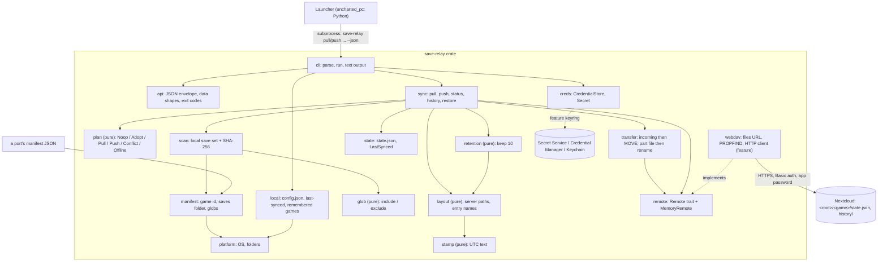

# Code map

The intended shape of the repo for 1.0 (`SPEC.md`, approved 2026-10-31): **one Rust crate, a library and a command-line tool**. A game's launcher runs `save-relay pull <game> --json` before Play and `save-relay push <game> --json` after the game quits; everything else (history, restore, setup) is the same binary. Later, Android and iOS builds link the library directly and supply their own `Remote` and `CredentialStore`.

Main at 2026-10-31 is the **skeleton**: every module below exists with its final public signatures; a function not built yet returns `Err(Error::NotBuilt(..))`, or panics with "not built yet" when its signature cannot fail. Status per module: **present** (built), **stub** (signatures only), **planned** (not in the tree yet). An issue that builds a module moves its status to present in the same PR.

## Platforms (R04)

| Platform | 1.0 | Built in CI | Notes |
|---|---|---|---|
| Linux (SteamOS on the AMD handheld and the Strix Halo tablet) | yes | `ubuntu-latest` | saves and config under XDG folders; password in the Secret Service (KWallet or GNOME Keyring). Game Mode may have no unlocked Secret Service: see `creds`. |
| Windows (the RTX 3090 Ti desktop) | yes | `windows-latest` | `%APPDATA%` / `%LOCALAPPDATA%`; password in Credential Manager; paths inside a save set always use `/`, converted at the file system edge. |
| macOS | no (Won't for 1.0) | `macos-latest` | built and tested on every push because it is free on a public repo, so nothing Mac-hostile creeps in before 2.0; Keychain backend. |
| Android, iOS | no (2.0, with the game ports) | no | the core takes no platform-only dependency: network and credentials are traits (`Remote`, `CredentialStore`), the real ones sit behind the `webdav` and `keyring` features, and `PathVars` comes from the host app there. |

Rules that keep it portable: pure Rust dependencies only (no C library, no OpenSSL: rustls); no `std::os::*` outside `platform` and `scan` (symlink check); save paths are `String`s with `/`, never `PathBuf`, until joined onto the saves folder; tests build their temp folders under `std::env::temp_dir()` and never assume a separator.

## How it fits together



## Server layout

Under one folder (`root`, default `save-relay`) of the user's Nextcloud files:

```text
<root>/<game>/state.json                      ServerState: revision, device, time, entry, files
<root>/<game>/history/<stamp>-<device>/...    one dated copy per push (and per conflict backup),
                                              with its file list in .save-relay-files.json
<root>/<game>/incoming/<stamp>-<device>/...   an upload in progress
```

The current saves are the history entry `state.json` names (`docs/adr/0001-current-is-a-history-entry.md`): a push uploads to `incoming/`, MOVEs it into `history/` once complete, then writes `state.json` with If-Match on the etag it read. A broken upload never becomes current; two machines pushing at once cannot both win (the loser gets `changed_on_server` and runs again, which then shows the conflict). Retention keeps the newest 10 entries per game, never the current one.

On each machine: `<config>/save-relay/config.json` (server, user, root, device; no password), `<data>/save-relay/last/<game>.json` (the revision and file list last synced), `<data>/save-relay/games/<game>.json` (the manifest and saves folder last used).

## Modules

| Path | Status | Owns | Interlinks | Musts |
|---|---|---|---|---|
| `src/error.rs` | present | `Error` with a stable `code()` per variant (the `--json` error codes), `NotBuilt`, `Result` | used by all | all |
| `src/platform.rs` | stub (`current`, `key` present) | `Platform` (linux, windows, mac, android, ios); `PathVars` (home, data, config, documents) from environment variables through a lookup function; `AppDirs` (`<config>/save-relay`, `<data>/save-relay`) | `manifest`, `local`, `cli` | M6, M7 |
| `src/manifest.rs` | stub | `Manifest` JSON (format, id, name, saves template per platform, include, exclude), validation, `{home}`/`{data}`/`{config}`/`{documents}` expansion | `platform`; read by `scan`, `sync`, `cli` | M7 |
| `src/glob.rs` | stub | `matches(pattern, path)` with `*`, `?`, `**`; `selected(include, exclude, path)` | used by `scan` | M7 |
| `src/scan.rs` | stub (`SaveSet` helpers present) | `FileEntry` (path, size, mtime, sha256), `SaveSet`, `hash_bytes`, `scan(dir, include, exclude)` | `glob`; used by `plan`, `transfer`, `sync` | M1, M2, M3 |
| `src/stamp.rs` | stub (`now` present) | UTC text: RFC 3339 (`2026-10-31T19:51:00Z`) and entry stamps (`20261031T195100Z`), both ways | used by `layout`, `state`, `sync` | M2, M4 |
| `src/state.rs` | stub (`save_set` present) | `ServerState` (`state.json`) and `LastSynced` JSON with checks | `scan`; used by `plan`, `local`, `sync` | M1-M3 |
| `src/layout.rs` | stub (`root` present) | `Layout`: every server path; `entry_name`, `parse_entry_name`, `device_slug` | `stamp`; used by `retention`, `transfer`, `sync` | M2, M4 |
| `src/plan.rs` | stub | **pure** `decide(intent, local, last, server) -> Decision` (the table in the file) | `scan`, `state`; used by `sync` | M1, M2, M3, M5 |
| `src/retention.rs` | stub | **pure** `to_drop(entries, keep, current)`; `KEEP = 10` | `layout`; used by `sync` | M4 |
| `src/remote.rs` | stub | the `Remote` trait (list, get, put with `Precondition`, mkcol, copy, move_to, delete), `ensure_dir`, `MemoryRemote` (the test server, with an offline switch) | implemented by `webdav`; used by `transfer`, `sync` | M1-M5 |
| `src/webdav.rs` | stub | `files_url`, `encode_segment`, `encode_path`, `parse_propfind` (pure); `WebDav` HTTP client behind feature `webdav` (ureq + rustls) | implements `Remote`; `creds::Secret` | M1-M6 |
| `src/transfer.rs` | stub | `upload_entry` (incoming with its file list `RECORD`, then MOVE into history), `read_record`, `download_entry` (part file, hash check, rename; delete files the entry lacks), `Counts` | `remote`, `layout`, `scan` | M1, M2, M3 |
| `src/creds.rs` | stub (`Secret` present) | `Secret` (prints `***`), `CredentialStore` trait, `account(server, user)`, `MemoryStore`, `KeyringStore` behind feature `keyring` | used by `cli`, `webdav` | M6 |
| `src/local.rs` | stub | `LocalStore`: `Config`, `LastSynced`, `GameRecord` files, written via a temp file and rename | `platform`, `state`, `manifest`; used by `sync`, `cli` | M1-M6 |
| `src/sync.rs` | stub | the engine: `Session`, `Game`, `Resolve`; `pull`, `push`, `status`, `history`, `restore` | everything above | M1-M5 |
| `src/api.rs` | stub (types present) | the launcher contract: envelope, `SyncData`, `StatusData`, `HistoryData`, `RestoreData`, `SetupData`, `Action`, exit codes | `error`, `plan`, `transfer`; used by `sync`, `cli` | M8 |
| `src/cli.rs`, `src/main.rs` | stub | `parse` (std only, no clap), `command_name`, `usage`, `run` (wires config, credentials, `WebDav`, `sync`, text or `--json`) | everything | M6, M8 |
| `tests/*.rs` | planned | one test file per module (the locked tests of Easy issues), plus `tests/cli_webdav.rs` | | all |
| `tests/fixtures/` | planned | a fixture game manifest and save files (M7) | | M7 |
| `.github/workflows/check.yml` | present | fmt, clippy (default and no features), build, test on Linux, Windows, macOS | | M8 |
| `.github/workflows/release.yml` | planned | on a `v*` tag: Linux x86_64 and Windows x86_64 binaries (and macOS, unsigned) attached to the release, for launchers to bundle | | M8 |
| `docs/manifest.md` | planned | the manifest format for port maintainers | | M7 |

## API shape

The contract launchers code against (`src/api.rs`). Add fields freely; never rename or remove one, and never change an error code.

### Invocation

```text
save-relay pull    <game> [--manifest <file>] [--saves-dir <dir>] [--resolve keep-server|keep-local] [--json]
save-relay push    <game> [--manifest <file>] [--saves-dir <dir>] [--resolve keep-server|keep-local] [--json]
save-relay status  <game> [--manifest <file>] [--saves-dir <dir>] [--json]
save-relay history <game> [--json]
save-relay restore <game> <entry> [--manifest <file>] [--saves-dir <dir>] [--json]
save-relay setup   --server <url> --user <name> [--device <name>] [--root <folder>] [--json]   (password: first line of stdin)
```

`<game>` is the manifest id. A launcher always passes `--manifest` (the file it ships) and `--saves-dir` (its saves folder setting); the CLI remembers both per game, so a person can later type `save-relay history uncharted-1`. Setup is once per machine, not per game (M6): the password is read from standard input so it never appears in a process list, and `--password` is refused.

### Envelope

Exactly one line on stdout with `--json`:

```json
{"ok":true,"command":"pull","data":{ ... }}
{"ok":false,"command":"pull","error":{"code":"auth_failed","message":"the server refused the user name or app password"}}
```

### `data` per command

`pull`, `push` (`SyncData`):

```json
{"game":"uncharted-1","action":"pulled","revision":7,
 "server":{"device":"strix-halo-tablet","time":"2026-10-31T19:51:00Z","revision":7},
 "local":{"device":"amd-handheld","time":"2026-10-30T21:02:11Z","revision":null},
 "backup":null,"counts":{"uploaded":0,"downloaded":3,"deleted":0},
 "message":"Pulled revision 7 from strix-halo-tablet (2026-10-31T19:51:00Z)."}
```

`action`: `noop` · `adopted` (same files both sides, record updated) · `pulled` · `pushed` · `offline` (pull, server unreachable: start the game anyway, M5) · `deferred` (push, server unreachable: pushed next time, M5) · `conflict` (nothing touched: ask the player, then call again with `--resolve`). `pull` can also answer `pushed`: saves made offline go up at the next launch that reaches the server, after the M3 check. `backup` names the history entry that keeps the side not chosen in a `--resolve`.

`status` (`StatusData`): `{"game","reachable":true,"would":"noop|adopt|pull|push|conflict|offline","server":Side|null,"local":Side|null,"last_synced_revision":7,"local_changed":false,"message"}`. Changes nothing.

`history` (`HistoryData`): `{"game","current":"20261031T195100Z-strix-halo-tablet","entries":[{"entry":"20261031T195100Z-strix-halo-tablet","device":"strix-halo-tablet","time":"2026-10-31T19:51:00Z","current":true}, ...]}`, newest first.

`restore` (`RestoreData`): `{"game","entry":"<restored from>","revision":8,"new_entry":"<copy made now>","backup":"<local changes kept first>"|null,"counts":{...},"message"}`.

`setup` (`SetupData`): `{"server","user","device","root","credential_store":"secret-service|windows-credential-manager|macos-keychain"}`. Never the password.

### Exit codes

| Code | Meaning |
|---|---|
| 0 | done, including `offline` and `deferred` (the game must still start) |
| 3 | `conflict`: a choice is needed, nothing changed |
| 2 | `usage`, `manifest_invalid`, `game_unknown`, `no_such_entry` |
| 4 | `not_set_up`, `auth_failed`, `credentials` |
| 5 | `server_unreachable` (history, restore, setup), `server_error`, `state_invalid`, `changed_on_server`, `not_found` |
| 1 | anything else (`io`, `not_built`) |

### Error codes

`not_built` · `usage` · `manifest_invalid` · `game_unknown` · `not_set_up` · `auth_failed` · `server_unreachable` · `server_error` · `state_invalid` · `changed_on_server` · `no_such_entry` · `not_found` · `credentials` · `io` (`Error::code`, `src/error.rs`).

### The launcher's flow

1. Play pressed: `pull <game> --manifest <m> --saves-dir <d> --json`.
   - exit 0: start the game; on `offline`, show "Playing offline: saves will upload next time."
   - exit 3 (`conflict`): show the prompt below, then `pull ... --resolve keep-server|keep-local --json`, then start.
   - exit 4: offer setup. Any other failure: show `error.message` and offer "Play with local saves".
2. Game quit: `push <game> ... --json`. `conflict` here gets the same prompt and a `push --resolve`.

The conflict prompt, from `data.server` and `data.local`:

> Your saves changed on this machine and on the server since they last synced.
> Server: saved on **strix-halo-tablet**, 2026-10-31 7:51pm. This machine: **amd-handheld**, 2026-10-30 9:02pm.
> Keep which? The other one stays in history and can be restored.
> [Keep the server's] [Keep this machine's]

Times are UTC in the JSON; the launcher shows them in local time.
