# Code map

The intended shape of the repo for 1.0 (`SPEC.md`, re-approved 2026-11-01): **one Rust crate, a library and a command-line tool**, plus the panel's front end (`panel/`) and its Game Mode shell (`decky/`). A game's launcher runs `save-relay pull <game> --json` before Play and `save-relay push <game> --json` after the game quits; everything else (history, restore, setup) is the same binary. The saves travel through the service chosen once at setup: Nextcloud (WebDAV), Google Drive or Dropbox, each a `Remote` (`docs/adr/0002-storage-backends.md`). Around that (M11-M15, `docs/adr/0003-baton-wrap-cards-panel.md`): `pull` leaves an open-elsewhere mark on the server that `push` clears; `save-relay wrap -- %command%` syncs any Steam game, its saves folder found in the ludusavi data; every push carries a save card; and the panel shows it all in Game Mode and in the browser. Later, Android and iOS builds link the library directly and supply their own `http::Transport` and `CredentialStore`.

**Implementation snapshot (2026-11-11).** A **present** row points to code in this tree; the audited main baseline was `a8e07ff`. **Planned** marks work not yet in this tree, tracked in [the run order](../ROADMAP.md#run-order-to-10). The M16 Steam Cloud filter, `steam-games` and `launch-option` commands, and Add games view are present with automated coverage. The browser panel and Decky shell share views. Device acceptance is tracked separately in the roadmap.

## Platforms (R04)

| Platform | 1.0 | Built in CI | Notes |
|---|---|---|---|
| Linux (SteamOS on the AMD handheld and the Strix Halo tablet) | yes | `ubuntu-latest` | saves and config under XDG folders; password or refresh token in the Secret Service (KWallet or GNOME Keyring). Game Mode may have no unlocked Secret Service (see `creds`) and may show no browser, so Drive and Dropbox setup there uses the code flows (see `oauth`). `wrap` finds Steam native or Flatpak and maps Windows-only games into their Proton prefix; the Decky plugin is the Game Mode panel. |
| Windows (the RTX 3090 Ti desktop) | yes | `windows-latest` | `%APPDATA%` / `%LOCALAPPDATA%`; password or refresh token in Credential Manager (2560-byte limit per entry: tokens fit); the browser opens with `rundll32 url.dll,FileProtocolHandler`; paths inside a save set always use `/`, converted at the file system edge. Steam in `C:\Program Files (x86)\Steam` unless `SAVE_RELAY_STEAM_DIR` says otherwise (no registry); `install-wrap` quotes the binary path. |
| macOS | no (Won't for 1.0) | `macos-latest` | built and tested on every push because it is free on a public repo, so nothing Mac-hostile creeps in before 2.0; Keychain backend; browser via `open`. Steam for Mac's folder is known, so `wrap` and `install-wrap` build and test here, unchecked on a device. |
| Android, iOS | no (2.0, with the game ports) | no | the core takes no platform-only dependency: the network and credentials are traits (`http::Transport`, `CredentialStore`), the real ones sit behind the `http` and `keyring` features, the three backends are plain Rust over `Transport`, and `PathVars` comes from the host app there. Mobile sign-in would use the platform's own browser session with the same PKCE parts. |

Rules that keep it portable: no system library to find at build or run time (no OpenSSL: rustls; `getrandom` for PKCE); the one exception to pure Rust is `ring`, rustls's crypto, which compiles its own bundled C and assembly with `cc` and builds for Linux, Windows, macOS, Android and iOS, so a build machine needs a C compiler (decided 2026-11-01, PR #50); no `std::os::*` outside `platform` and `scan` (symlink check); save paths are `String`s with `/`, never `PathBuf`, until joined onto the saves folder; tests build their temp folders under `std::env::temp_dir()` and never assume a separator.

## How it fits together

```mermaid
flowchart TD
    L["Launcher (uncharted_pc: Python)"] -->|"subprocess: save-relay pull/push ... --json"| CLI
    Steam["Steam launch option: save-relay wrap -- %command%"] --> CLI
    Decky["decky/: Game Mode plugin (main.py runs save-relay --json)"] -->|subprocess| CLI
    Front["panel/: shared views (React), Bridge"] --> Decky
    Front -->|"POST /api/&lt;command&gt;, token"| PanelSrv
    subgraph crate["save-relay crate"]
      CLI["cli: parse, run, text output"] --> API["api: JSON envelope, data shapes, exit codes"]
      CLI --> Local["local: config.json, last-synced, remembered games"]
      CLI --> Creds["creds: CredentialStore, Secret"]
      CLI --> Sync["sync: pull, push, status, history, restore, repair, where, picture"]
      Sync --> Plan["plan (pure): Noop / Adopt / Pull / Push / Conflict / Offline / Held"]
      Plan --> Presence["presence (pure): playing.json mark, Free / Mine / Elsewhere"]
      Sync --> Presence
      Sync --> Card["card (pure): save card, sidecar, picture check"]
      Transfer --> Card
      CLI --> Wrap["wrap: pull, child process, push"]
      Wrap --> Sync
      Wrap --> Pending["pending: pending choices, answer"]
      Pending --> Local
      Wrap --> Lud["ludusavi: data cache, entry to manifest"]
      Lud --> Steam2["steam: folders, libraries, users, screenshots"]
      Steam2 --> Vdf["steam::vdf (pure): KeyValues"]
      CLI --> Launch["steam::launch: install-wrap, LaunchOptions"]
      Launch --> Vdf
      Lud --> Http
      Lud --> Manifest
      CLI --> PanelSrv["panel: 127.0.0.1 server, token, embedded front end"]
      PanelSrv --> CLI
      Sync --> Ret["retention (pure): keep 10"]
      Sync --> Transfer["transfer: incoming then MOVE; part file then rename"]
      Sync --> State["state: state.json, LastSynced"]
      Sync --> Layout["layout (pure): server paths, entry names"]
      Sync --> Scan["scan: local save set + SHA-256"]
      Scan --> Glob["glob (pure): include / exclude"]
      Scan --> Manifest["manifest: game id, saves folder, globs"]
      Manifest --> Platform["platform: OS, folders"]
      Local --> Platform
      Transfer --> Remote["remote: Remote trait + MemoryRemote"]
      Sync --> Remote
      Ret --> Layout
      Layout --> Stamp["stamp (pure): UTC text"]
      CLI --> Service["service: Nextcloud / Google Drive / Dropbox, open()"]
      Service --> WebDav
      Service --> Dropbox
      Service --> Drive
      WebDav["webdav: files URL, PROPFIND, If-Match"] -.implements.-> Remote
      Dropbox["dropbox: API v2, rev-checked upload"] -.implements.-> Remote
      Drive["gdrive: REST v3, ids, guard (claim files)"] -.implements.-> Remote
      Dropbox --> OAuth["oauth: PKCE, loopback / code / device sign-in, TokenSource"]
      Drive --> OAuth
      OAuth --> Clients["clients: public app ids"]
      WebDav --> Http["http: Request, Response, Transport"]
      Dropbox --> Http
      Drive --> Http
      OAuth --> Http
      Fake["fake: FakeDropbox, FakeDrive (tests)"] -.implements.-> Http
      Http -.feature http.-> Ureq["UreqTransport: ureq + rustls"]
      Creds -.feature keyring.-> OS[("Secret Service / Credential Manager / Keychain")]
    end
    Ureq -->|HTTPS, Basic auth, app password| NC[("Nextcloud: &lt;root&gt;/&lt;game&gt;/...")]
    Ureq -->|HTTPS, bearer token| DB[("Dropbox: Apps/save-relay/&lt;root&gt;/&lt;game&gt;/...")]
    Ureq -->|HTTPS, bearer token, drive.file| GD[("Google Drive: My Drive/&lt;root&gt;/&lt;game&gt;/...")]
    Port["a port's manifest JSON"] --> Manifest
```



## Server layout

The same tree on every service, under one folder (`root`, default `save-relay`): in the user's Nextcloud files; in Dropbox under the App folder (`Apps/<app name>/save-relay/`); in Google Drive as a `save-relay` folder in My Drive, created by the app (`drive.file`):

```text
<root>/<game>/state.json                      ServerState: revision, device, time, entry, files
<root>/<game>/playing.json                    the open-elsewhere mark: device, since, revision_read (M11)
<root>/<game>/history/<stamp>-<device>/...    one dated copy per push (and per conflict backup),
                                              with its file list in .save-relay-files.json, its save
                                              card in .save-relay-card.json and the card's picture in
                                              .save-relay-picture.jpg or .png (M14; old entries: none)
<root>/<game>/incoming/<stamp>-<device>/...   an upload in progress
<root>/<game>/rev/<n>                         Nextcloud only: the claim on revision n, created before
                                              state.json is written (body: the entry it names); the
                                              newest 10 are kept (#149); repair releases a stranded
                                              next claim and moves its complete entry aside (#159)
<root>/<game>/set-aside/rev<n>-<entry>        Nextcloud only: a complete entry that repair moved out of
                                              history/ with its stranded claim n; kept for recovery by hand (#159)
```

The current saves are the history entry `state.json` names (`docs/adr/0001-current-is-a-history-entry.md`): a push uploads to `incoming/`, MOVEs it into `history/` once complete, then writes `state.json` with `Precondition::Match` on the etag it read: `If-Match` on WebDAV, which is not enough alone on a server whose etag can repeat for two writes in one second with one size (Nextcloud 33 gives every write a fresh etag, so there `If-Match` alone refuses a stale push), so a WebDAV server first gets a create-once claim `rev/<n+1>` (`Precondition::Absent`) to decide which push or restore may write (a refused claim is `changed_on_server`, and a failed state write attempts to release the claim; #149; Google Drive and Dropbox create no revision markers), the file's `rev` on Dropbox, the claim guard on Google Drive (`docs/adr/0002-storage-backends.md`; Drive also keeps small `.claim-<id>` files beside `state.json` for a day). A broken upload never becomes current; two machines pushing at once cannot both win (the loser gets `changed_on_server` and runs again, which then shows the conflict). A crash before state is written can strand a claim on WebDAV; `save-relay repair <game>` releases the next-revision claim after confirming `state.json` has not moved, moving a complete entry it names to `set-aside/` first, and keeps later claims (ADR 0002; `RepairData`; #159). A server change during repair returns `changed_on_server` (exit 5). Retention keeps the newest 10 entries per game, never deleting the current one; a card goes with its entry. `playing.json` is written with `Precondition::Any` by `pull` and deleted by `push` only when it names this device (`docs/adr/0003-baton-wrap-cards-panel.md`); it is advice, so it never takes part in the compare-and-swap.

On each machine: `<config>/save-relay/config.json` (server, user, root, device; no password or token; `server` is the Nextcloud address, or `gdrive` / `dropbox`, which names the service: `service::Service::from_server`), `<data>/save-relay/last/<game>.json` (the revision and file list last synced), `<data>/save-relay/games/<game>.json` (the manifest and saves folder last used), `<data>/save-relay/session/<game>.json` (when this machine's last `pull` ran, for the card's playtime), `<data>/save-relay/pending/<game>.json` (a pending choice a wrapped game waits on), `<data>/save-relay/ludusavi/` (the cached ludusavi data `manifest.yaml`, its ETag and `steam-index.json`).

In a saves folder, every name starting `.save-relay-` is reserved and never part of a save set: a port's sidecar `.save-relay-meta.json` (place name and picture for the next card) and the part files of a download.

## Modules

| Path | Status | Owns | Interlinks | Musts |
|---|---|---|---|---|
| `src/error.rs` | present | `Error` with a stable `code()` per variant (the `--json` error codes, including `reauth_needed`, `sign_in_failed`, `save_location_unclear`, `steam_not_found`, `steam_running`, `no_pending_choice`), `Result` | used by all | all |
| `src/platform.rs` | present | `Platform` (linux, windows, mac, android, ios); `PathVars` (home, data, config, documents) from environment variables through a lookup function; `AppDirs` (`<config>/save-relay`, `<data>/save-relay`) | `manifest`, `local`, `cli` | M6, M7 |
| `src/manifest.rs` | present | `Manifest` JSON (format, id, name, saves template per platform, optional `saves_from: "launcher"` for a folder only the launcher knows (#48), include, exclude), validation, `{home}`/`{data}`/`{config}`/`{documents}` expansion | `platform`; read by `scan`, `sync`, `cli` | M7 |
| `src/glob.rs` | present | `matches(pattern, path)` with `*`, `?`, `**`; `selected(include, exclude, path)` | used by `scan` | M7 |
| `src/scan.rs` | present | `FileEntry` (path, size, mtime, sha256), `SaveSet`, `hash_bytes`, `scan(dir, include, exclude)`; a reserved name (`.save-relay-*`, `card::is_reserved`) is never kept, cards present (M14) | `glob`, `card`; used by `plan`, `transfer`, `sync` | M1, M2, M3, M14 |
| `src/stamp.rs` | present | UTC text: RFC 3339 (`2026-10-31T19:51:00Z`) and entry stamps (`20261031T195100Z`), both ways | used by `layout`, `state`, `sync` | M2, M4 |
| `src/state.rs` | present | `ServerState` (`state.json`) and `LastSynced` JSON with checks | `scan`; used by `plan`, `local`, `sync` | M1-M3 |
| `src/layout.rs` | present | `Layout`: every server path (`playing_path` and the `rev/` claims, `rev_dir` and `rev_path`, too, #149); `entry_name`, `parse_entry_name`, `device_slug` | `stamp`; used by `retention`, `transfer`, `sync` | M2, M4 |
| `src/plan.rs` | present | **pure** `decide(intent, local, last, server) -> Decision` (the table in the file); `decide_with_mark` adds the `Held` row (M11) | `scan`, `state`, `presence`; used by `sync` | M1, M2, M3, M5, M11 |
| `src/retention.rs` | present | **pure** `to_drop(entries, keep, current)`, `markers_to_drop(names, keep, current)` (the revision claims, newest by number; current and later claims protected, #149); `KEEP = 10` | `layout`; used by `sync` | M4 |
| `src/remote.rs` | present | the `Remote` trait (list, get, put with `Precondition`, mkcol, copy, move_to, delete): **the storage interface**; etags are opaque per backend; `needs_rev_marker` (true for WebDAV: the engine claims each revision first, #149), `ensure_dir`, `MemoryRemote` (the test server, with an offline switch) | implemented by `webdav`, `dropbox`, `gdrive`; used by `transfer`, `sync` | M1-M5, M9 |
| `src/http.rs` | present | `Request` (its `Debug` hides `Authorization`), `Response`, the `Transport` trait; `UreqTransport` behind feature `http` (ureq + rustls, timeouts 5 s / 60 s) | used by `webdav`, `dropbox`, `gdrive`, `oauth`; implemented by `fake` | M1-M6, M9 |
| `src/service.rs` | present | `Service` (nextcloud, gdrive, dropbox): keys, labels, `parse`, `from_server` (the config's `server` field), `uses_oauth`; `token_account`, `pending_account`, `google_client_account` (which Google client a refresh token was issued to), `credential_accounts` (what a switch deletes); `open` / `open_with` (returns `Opened`: the backend and its `TokenSource`, for `rotated()`); `sign_in_account` (the e-mail address and the backend straight after a sign-in); `client_for` | `local`, `creds`, `clients`, `webdav`, `dropbox`, `gdrive`, `oauth`; used by `cli` | M6, M9, M10 |
| `src/webdav.rs` | present (`files_url`, `encode_segment`, `encode_path`, `parse_propfind`, `WebDav` with all seven methods, checked on the Nextcloud test container by the ignored `tests/webdav_live.rs`) | Nextcloud: `files_url`, `encode_segment`, `encode_path`, `parse_propfind` (pure, `quick-xml`); `WebDav` over a `Transport`, Basic auth, `If-Match`; `needs_rev_marker` is true (#149) | implements `Remote`; `http`, `creds::Secret` | M1-M6, M9 |
| `src/dropbox.rs` | present | Dropbox API v2: `api_path`, `header_json`, `upload_arg`, `classify` (`Op`, `Outcome`), `parse_list` (`ListPage`), `parse_rev` (pure); `Dropbox` over a `Transport` + `TokenSource`, rev-checked uploads, parent checks, `account_email` | implements `Remote`; `http`, `oauth` | M6, M9, M10 |
| `src/gdrive.rs` | present | Google Drive v3: `DriveFile`, `escape_q`, `children_query`, `parse_files` (`FilePage`), `parse_file`, `pick` (oldest wins), `multipart_body` (pure); `Drive` over a `Transport` + `TokenSource`: oldest-wins path resolution, one-update `move_to`, recursive file copies, the claim guard on `Match` with server lease ages and day-old claim cleanup, bounded retries with injectable wait, `account_email`; `tests/drive_backend.rs` exercises the Remote contract and two-machine races | implements `Remote`; `http`, `oauth`, `gdrive::guard` | M6, M9, M10 |
| `src/gdrive/guard.rs` | present | **pure** the M9 guard for Drive: `make_etag`, `parse_etag`, `Claim`, `Step`, `decide` (the table in the file), `check_written`; `LEASE_SECS` 120, `SLOW_SECS` 60, `MAX_HOPS` 3 | used by `gdrive` | M9 |
| `src/oauth.rs` | present | PKCE (`base64url`, `verifier_from_bytes`, `challenge`, `random_bytes`), `form_encode`, `authorize_url`, `parse_redirect`, `Tokens`, `parse_token_response`, `needs_refresh` (pure); `TokenSource` (refresh, cache, rotation; a clone shares the state, so `cli` can read `rotated()` after a backend used the other); `Pending`; `sign_in_browser` (loopback), `start_code` / `finish_code` (Dropbox code, Google device flow), `in_game_mode`, `open_browser` | `http`, `clients`, `creds::Secret`, `service`; used by `dropbox`, `gdrive`, `service`, `cli` | M6, M10 |
| `src/clients.rs` | present (values empty until registered) | the public app registrations: `GOOGLE_DESKTOP`, `GOOGLE_DEVICE`, `DROPBOX` (`Client`), `DROPBOX_REDIRECT`; `ClientSet` (`shipped()`, so tests pass their own ids); `registered` (an empty id is `Error::Usage`: "not registered yet"); build-time overrides for forks | used by `oauth`, `service`, `cli` | M6, M10 |
| `src/fake/dropbox.rs` | present | `FakeDropbox`: the Dropbox API in memory as a `Transport` (pages of 2, rev-checked uploads that create parents, copies and moves of whole folders, offline switch, revoke, expire, the sign-in code exchange for `SIGN_IN_CODE`) | `http`; used by tests | M9 |
| `src/fake.rs`, `src/fake/gdrive.rs` | present | `FakeDrive`: the Drive API in memory as a `Transport` (ids, parents, repeated names, versions, pages of 2, `alt=media`, `addParents`/`removeParents`, offline switch, revoke, expire, Drive's 409 on a used id, a hook to slip a second machine in), `REFRESH_TOKEN`, and the device flow (`device/code` with the `scope` recorded for `device_scope()`, the device grant answered with tokens for `DEVICE_CODE`) | `http`; used by tests | M9, M10 |
| `src/transfer.rs` | present | `upload_entry` (incoming with its file list `RECORD`, then MOVE into history), `read_record`, `download_entry` (part file, hash check, rename; delete files the entry lacks), `Counts`; `put_card`, `read_card`, `get_picture` (M14) | `remote`, `layout`, `scan`, `card` | M1, M2, M3, M14 |
| `src/creds.rs` | present (`Secret`, `CredentialStore`, `account`, `MemoryStore`; `KeyringStore` present, #18) | `Secret` (prints `***`), `CredentialStore` trait, `account(server, user)` (Nextcloud passwords; tokens use `service::token_account`, pending sign-ins `"pending:<service>"`, a Google refresh token's client kind `"gdrive-client:<user>"`), `MemoryStore`, `KeyringStore` behind feature `keyring`, `EnvPasswordStore` and `test_password_from_env` (`SAVE_RELAY_TEST_PASSWORD`, read only in debug builds, for the integration tests) | used by `cli`, `service`, `webdav` | M6 |
| `src/local.rs` | present | `LocalStore`: `Config`, `LastSynced`, `GameRecord`, `Session` (playtime start) and pending-choice files, `list_games` (sorted game ids, M11 `where`), written via a temp file and rename | `platform`, `state`, `manifest`; used by `sync`, `cli` | M1-M6 |
| `src/sync.rs` | present | the engine: `Session`, `Game`, `Resolve`; `pull` (with `anyway`), `push` (both return `SyncReport`), `status`, `history`, `repair`, `restore`, `where_open`, `picture` | everything above | M1-M5, M11, M14, #159 |
| `src/api.rs` | present | the launcher contract: envelope, `SyncData` and `SyncReport` (with `held` and the cards), `StatusData` (with `service`, `held`, `pending`), `HistoryData` (with cards), `RepairData` and marker outcomes, `RestoreData`, `SetupData` (with `service`), `SignInPrompt`, `WhereData`, `WhichData`, `SteamGamesData` (`SteamGame`, `SteamCloud`, `SteamSaves`; F74/F75 shared `no_cloud_with_saves` selector), `InstallWrapData` (`skipped` with `steam_cloud_unknown` / `no_saves_entry`), `LaunchOptionData`, `AnswerData`, `PictureData`, `PanelData`, `Held`, `Action`, exit codes | `error`, `plan`, `transfer`, `card`, `pending`; used by `sync`, `cli`, `wrap` | M6, M8, M11-M16 |
| `src/presence.rs` | present | **pure** `Mark` (`playing.json`) with checks; `check(mark, this_device) -> Hold` (`Free`, `Mine`, `Elsewhere`) | used by `plan`, `sync` | M11 |
| `src/card.rs` | present | **pure** `Card` (`.save-relay-card.json`), `Sidecar` and `parse_sidecar`, `check_picture` (JPEG or PNG, 512 KiB), `clean_place` (80 characters), `playtime` (24 hours), `is_reserved`, `for_push` | `stamp`; used by `transfer`, `sync`, `wrap`, `api` | M14 |
| `src/pending.rs` | present | `PendingChoice` (`pending/<game>.json`), `ChoiceKind`, `Answer`; `answer`; `wait_for_answer` (120 s, injected clock and sleep) | `api`, `card`, `local`; used by `wrap`, `cli`, `sync` | M12 |
| `src/steam.rs` | present | Steam facts: `find_root` per OS (`SAVE_RELAY_STEAM_DIR` first), `parse_libraries`, `library_for`, `parse_install_dir`, `parse_app_name` (from `appmanifest_<id>.acf`), `proton_prefix`, `user_ids`, `screenshot_dir`, **pure** `pick_screenshot`; `app_id_from_env`, `game_id` (`steam-<appid>`) | `steam::vdf`, `platform`; used by `ludusavi`, `wrap`, `steam::launch`, `cli` | M12-M14, F72, F74 |
| `src/steam/vdf.rs` | present | **pure** KeyValues text: `Vdf` (`get`, `get_path`, `as_str`, `set_path`), `parse`, `to_text` | used by `steam`, `steam::launch` | M12, M13 |
| `src/steam/launch.rs` | present | `install-wrap`: `wrapped`, `is_wrapped`, `unwrapped` (pure; not exact for the groups its doc names: `None`, `""` and `%command%` alone; `%command%` at the start followed by a space; an option already wrapped), `launch_options`, `set_launch_options`, `backup_name`, `installed_among` (pure), `steam_running` (Linux pid files and `/proc`, Mac `kill -0` on a pid file whose place is unverified, Windows `tasklist`, a failed `tasklist` is an error), `install` (program named `save-relay`, a run lock, dated backup, temp file and rename, refused while Steam runs, a wrap refuses a Steam user with no file); F76 `launch-option` reuses `wrapped` / `unwrapped` without file access | `steam`, `steam::vdf`, `api`, `stamp`; used by `cli` | M13, F76 |
| `src/steam/cloud.rs` | present | `appdetails_url`, `parse_appdetails` -> `StoreAnswer` (`Game { cloud }`, `NotAGame`, `Unknown`; Steam Cloud is store category 23); `Cache::open`, `refresh` over `http::Transport` (one week, at most 100 requests per run, stops on 429 or unreachable), `state` -> `CloudState`; stores even `Unknown` for one week; atomic per-answer writes under a sidecar lock | `serde_json`, `http`, `platform`; used by `cli` | M16, F73-F74 |
| `src/ludusavi.rs` | present | the ludusavi data: `Entry`, `FileRule`, `When`, `SteamRef`, `parse` (YAML with serde-saphyr, budgets raised for the real file), `steam_index`, `SteamIndex`, `needs_refresh` (a week); **pure** `candidates` and `translate(name, entry, facts, exists, is_dir) -> Located` (placeholders, `when`, Proton prefix, refuses unclear); `Cache` (`refresh` with ETag, atomic writes, `index`, `lookup`; files `manifest.yaml`, `steam-index.json`, `meta.json`) | `http`, `manifest`, `platform`, `steam`; used by `cli` (`which`, and `wrap`'s saves folder) | M13 |
| `src/wrap.rs` | present | `game_id`, the `Engine` trait (pull, push), `choice_for`, `resolve_for`, `run_child` (inherited standard streams, the child's exit code), `run` (pull, a pending choice waited up to 120 s, child, push; the game always starts) | `sync`, `pending`, `api`, `local`, `steam`; used by `cli` | M12 |
| `src/panel.rs` | present | `save-relay panel`: the loopback server on 127.0.0.1 (std only): `assets::ASSETS` (embedded `panel/dist` with feature `panel-dist`, else a placeholder page), `token_from_bytes`, `Request`, `parse_request`, `Route`, `route` (the token in constant time, every request needs it; `served_page` puts it on the page's `./app.js` and `./app.css` references), `api_args` (the command line for each `POST /api/<command>`, including Steam game listing, install-wrap and launch-option), `response`, `serve` (announces the URL with the token, runs one connection at a time); `TOKEN_HEADER`, `API_COMMANDS`; `GET /picture/<game>/<entry>` serves the card picture | `api`, `card`, `oauth` (`random_bytes`, `base64url`, `open_browser`); std and `serde_json`; used by `cli` (`panel_command`) | M15, F76 |
| `src/cli.rs`, `src/main.rs` | present | `parse` (std only, no clap; `Command::Setup` for Nextcloud, `Command::SetupService` + `SignInStep` for Drive and Dropbox), `command_name`, `usage`, `run` (the real environment) and `run_with` / `run_with_net` (injectable remote, credential store, folders, and for the services `Net`: transport, browser opener, `ClientSet`, Game Mode, clock); `steam-games` lists installed appmanifest entries with store, ludusavi, local-manifest and launch-option state; `install-wrap --no-steam-cloud` selects known-save games with cloud=no and reports unknown or missing-save skips; `steam_games_data` builds the shared listing used by the F78 flow | everything | M6, M8, F74-F76, F78 |
| `src/lib.rs` | present | the module list | all modules | all |
| `tests/*.rs` | present | one test file per module, the locked tests of Easy issues: `api`, `api_contract` (reads `panel/src/fixtures/`), `card`, `cli_parse` (+ `_baton`, `_service`), `cli_run`, `cli_launch_option` (F76: actual executable path and current option preservation), `cli_steam_games` (F74: installed games, cached state, and offline behavior), `cli_services` (Google Drive and Dropbox setup and status through `run_with_net` and the fakes), `creds`, `glob`, `http_transport`, `layout`, `local`, `ludusavi_cache`, `ludusavi_translate`, `manifest` (+ `_saves_from`), `panel` (the loopback server: parser, routes, API arguments, a real socket with a fake runner), `pending`, `plan` (+ `_held`), `platform`, `presence`, `remote` (+ `memory_remote_move_into_self`), `retention`, `scan`, `sync_cards` (M14), `sync_rev_marker` (#149: the revision claim on a fake whose etag repeats, its release and its pruning), `sync::repair_tests` (#159: incomplete released, complete set aside, later kept, publish before and after the move, no marker) and `repair` (#159: a push that dies at its state write, then repair and the next push; the CLI prompt, `--json` and `--yes`), `service`, `services_doc`, `stamp`, `state`, `steam`, `steam_launch` (`install-wrap`: the text rules, the VDF edit, backups and `--remove` over temp copies), `steam_vdf`, `webdav_propfind`, `webdav_urls`, `wrap_flow` (M12: the flow over a scripted engine, a real child process, and the command with a set-up machine), `webdav_live` (ignored: needs a Nextcloud test container); the backend and sign-in suites: `dropbox_answers`, `dropbox_requests`, `dropbox_backend`, `fake_dropbox`, `gdrive_answers`, `gdrive_guard`, `drive_backend`, `fake_drive`, `oauth_pkce`, `oauth_urls`, `oauth_tokens`, `oauth_flows`, `oauth_token_source`; `cli_webdav` (ignored: the built CLI against a WebDAV server, in CI's `integration` job; M1-M5 and M7, and M6 for the `--password VALUE` form only; M4 includes `two_pushes_in_one_second_both_keep_a_dated_copy` (#148), run by the job alongside the other ignored WebDAV tests; its racing-push write-guard test runs on Linux only, against Nextcloud, because rclone 1.73.5 ignores `If-Match` and `If-None-Match`, the server the Windows and macOS legs use, and it proves a write one second later with a different size only; the revision claim is `a_taken_revision_claim_refuses_the_push_on_nextcloud`, also Linux only and against Nextcloud: a taken `rev/<n+1>` refuses the push with `changed_on_server` and Nextcloud answers 412 to a second `If-None-Match: *` create; #149)) | | all |
| `tests/remote_contract.rs`, `tests/sync_services.rs` | present | the M9 suite: the same `Remote` contract (#12's checks over `&dyn Remote`) and the same pull / push / conflict / resolve / restore / offline / racing-push scenarios, two machines over one remote, against `MemoryRemote`, `Dropbox` + `FakeDropbox` and `Drive` + `FakeDrive`; the backends are built by `tests/common/mod.rs`, fresh per test | | M1-M5, M9 |
| `tests/live_services.rs` | present | `#[ignore]` real round trips against Dropbox and Google Drive with the owner's own sign-in (contract, two-machine round trip, racing pushes, and for Drive the 409 on a reused claim id; the consent URL), each in its own `save-relay-live-test-<tag>` folder; skips when its config variable is unset; run by hand on a PC (`needs-owner-device`), see `docs/services.md` | | M9, M10 |
| `docs/services.md` | present | choosing a service, setup per service, Game Mode, switching services | | M6, M10 |
| `tests/fixtures/` | present | the fixture game (`games/fixture-game.json` and `saves/fixture-game/`) and a second game with only its manifest (`games/second-game.json`), both made up, for `cli_webdav` | | M7 |
| `panel/` | present | the panel's front end (TypeScript, React 18, Vite, vitest; pnpm workspace): `src/api.ts` (the envelope types, mirroring `src/api.rs`, including F76 Steam payloads), `src/bridge.ts` (`Bridge`, `httpBridge`, Steam API commands), `src/App.tsx` (loads over the Bridge and routes), `src/views.tsx` (games, history with restore and confirm, conflict, held, pending, QR sign-in, F77 Add games with Cloud/save state and selected-ID actions), `src/focus.ts` (d-pad / A / B as arrows / Enter / Escape), `src/actions.ts`, `src/fixtures/*.json` (one envelope per command and outcome, including steam-games, install-wrap and launch-option: the contract `tests/api_contract.rs` and `src/api.test.ts` both read), `src/fixtureBridge.ts` (the views on fixtures when the page has no token), `src/format.ts` (times and playtime for the views), `src/main.tsx` (the browser entry: picks the HTTP or the fixture bridge), `vite.config.ts`, and tests beside the code (`api`, `bridge`, `views`, `focus`, `focus.dom` and design regression tests); `pnpm --dir panel build` writes `dist/` (`index.html`, `app.js`, `app.css`), which `--features panel-dist` embeds; `placeholder/index.html` otherwise | used by `decky/`, served by `panel` | M15, F76 |
| `decky/` | present | the Game Mode shell (MIT code in the GPL-2.0 Decky Loader host): `plugin.json`, `main.py` (`Plugin.run` maps panel arguments to a bundled-or-PATH `save-relay ... --json`, with a timeout and error envelopes; `Plugin.picture` reads temporary pictures as data URLs; F76 forwards Steam games, install-wrap and launch-option), `src/index.tsx` (shared `panel/App` in quick access, scoped shared styles, Steam D-pad and B dispatched to the panel focus scope, and styles constrained to the 268px Quick Access menu), `src/bridge.ts` (`deckyBridge`, including F77 Game Mode launch-option read/echo flow), `src/assets.d.ts` (asset typings), `test_main.py` and `src/*.test.*` (vitest, `vitest.config.ts`); built with `@decky/rollup` (`rollup.config.js`), React and `@decky/ui` supplied by Decky at runtime; device load is F67; Add games API path is automated-tested, handheld acceptance remains pending | `panel/` | M15, F76-F77 |
| `tests/fixtures/steam-games/` | present | made-up Cloud, no-Cloud, unknown and tool apps with one wrapped launch option, used by F74/F75 | | F74 |
| `tests/fixtures/ludusavi/steam-games.yaml` | present | made-up F78 Steam entries and installed folder names for the shared end-to-end flow | | F78 |
| `tests/fixtures/ludusavi/` and `tests/ludusavi_cache.rs` | present | fixture ludusavi data (made-up games; `manifest.yaml`) and the reader, index, weekly ETag refresh, lookup and `which` tests against a fake `http::Transport` | | M13 |
| `tests/steam_games_flow.rs` | present | F78: discover Cloud/no-Cloud/unknown games, invoke the shipped installer against the isolated fixture, verify the launch option, run the fixture child, and assert its save reaches `MemoryRemote` | | F78 |
| `tests/wrap.rs`, `tests/baton.rs` | present | `baton`: a handheld and a desktop over one `MemoryRemote` through `run_with --json` (the mark, held, `--anyway`, a conflict with two cards, `where`, `history`, `picture`) with the fixture sidecar `tests/fixtures/sidecar/`; `wrap`: a wrapped fixture program (this test binary run again) with the fixture Steam folder `tests/fixtures/steam/` and ludusavi data `tests/fixtures/ludusavi/wrap.yaml` over a fake transport (pull, push, a second machine, an answer from a thread, no answer, `which`, `install-wrap --dry-run` through the real binary) (F65) | | M11-M14 |
| `docs/wrap.md`, `docs/panel.md` | present | wrap, which, install-wrap and Proton; the panel in Game Mode and the browser (F66); `docs/wrap.md` includes Steam Cloud and unknown-state guidance; `docs/panel.md` documents browser bulk confirmation, Steam-closed requirement, and the Game Mode client echo flow with handheld acceptance pending (F78) | | M12-M15, F78 |
| `.github/workflows/check.yml` | present | fmt, clippy (default and no features), build, test on Linux, Windows, macOS; a `frontend` job on Linux: pnpm install, typecheck, vitest, build, then `cargo build --features panel-dist` | | M8, M15 |
| `.github/workflows/release.yml` | present | on a `v*` tag: Linux x86_64 (static, musl) and Windows x86_64 binaries, and macOS arm64 (unsigned), built with `--features panel-dist` and attached with `SHA256SUMS` to the release, for launchers to bundle; the Decky plugin zip (with the Linux binary as `bin/save-relay`) and the panel zip (`panel/dist`) are attached too; `workflow_dispatch` makes the same files as run artifacts only (dry run), and so does a pull request that changes this file; a tag refuses to build unless the five app ids are set and contain no whitespace (#36) | | M8, M15 |
| `docs/manifest.md` | present | the manifest format for port maintainers | | M7 |

The live WebDAV job exercises the built CLI using Nextcloud on Linux and rclone on Windows and macOS. The Linux job also checks the real Nextcloud write preconditions. Drive and Dropbox contract tests use fake transports; their live suite is run with the owner's sign-in.

## API shape

The contract launchers code against (`src/api.rs`). Add fields freely; never rename or remove one, and never change an error code.

### Invocation

```text
save-relay pull    <game> [--manifest <file>] [--saves-dir <dir>] [--resolve keep-server|keep-local] [--json]
save-relay push    <game> [--manifest <file>] [--saves-dir <dir>] [--resolve keep-server|keep-local] [--json]
save-relay status  <game> [--manifest <file>] [--saves-dir <dir>] [--json]
save-relay history <game> [--json]
save-relay repair  <game> [--yes] [--json]
save-relay restore <game> <entry> [--manifest <file>] [--saves-dir <dir>] [--json]
save-relay setup   [--service nextcloud] --server <url> --user <name> [--device <name>] [--root <folder>] [--json]   (password: first line of stdin)
save-relay setup   --service gdrive|dropbox [--no-browser | --finish] [--device <name>] [--root <folder>] [--json]
save-relay setup   [--device <name>] [--root <folder>]                     (asks which service on stdin; not with --json)
save-relay pull    <game> --anyway [...]                                   (play past another machine's mark, M11)
save-relay where   [--json]                                                (who has each game open, M11)
save-relay wrap    [--game <id>] [--manifest <file>] [--saves-dir <dir>] -- <command>...   (Steam: wrap -- %command%, M12)
save-relay which   <appid> [--json]                                        (a wrapped game's saves folder, M13)
save-relay install-wrap (<appid>... | --all-known) [--remove] [--dry-run] [--json]   (Steam must be closed, M13)
save-relay steam-games [--no-steam-cloud] [--refresh] [--json]             (installed Steam games and their Steam Cloud state, F74)
save-relay install-wrap --no-steam-cloud [--dry-run] [--json]              (wrap installed games with cloud=no and known saves; reports skips, M16)
save-relay launch-option <appid> [--remove] [--current <text>] [--json]    (Game Mode: calculate text from current app details, F76)
save-relay answer  <game> keep-server|keep-local|play-anyway|wait [--json] (a pending choice, M12)
save-relay picture <game> <entry> --out <file> [--json]                    (a card's picture, M14)
save-relay panel   [--port <n>] [--no-open] [--json]                       (the panel in the browser, M15)
```

`<game>` is the manifest id. A launcher always passes `--manifest` (the file it ships) and `--saves-dir` (its saves folder setting); the CLI remembers both per game, so a person can later type `save-relay history uncharted-1`. Setup is once per machine, not per game (M6), and every machine uses the one service the owner chose. Nextcloud: the app password is read from standard input so it never appears in a process list, and `--password` is refused. Google Drive and Dropbox: setup opens the system browser and waits for the sign-in (PKCE, loopback redirect on `127.0.0.1`); with `--no-browser` (the default in Steam's Game Mode) it prints a `SignInPrompt` instead and `--finish` completes it (Dropbox: the code it showed, on the first line of stdin; Google: polls until the person typed the code on google.com/device). The refresh token goes to the credential store only.

`wrap` is not called by a launcher but set as a Steam launch option (`install-wrap` writes it). Its game id is `--game`, else `steam-<appid>` from `SteamAppId`, `SteamGameId` or `STEAM_COMPAT_APP_ID`; its saves folder is a manifest of my own when there is one, else the ludusavi data's. It prints nothing of its own on stdout (the game's output passes through) and exits with the game's exit code. `panel` with `--json` prints `PanelData` once it listens, then serves until stopped.

### Envelope

Exactly one line on stdout with `--json`:

```json
{"ok":true,"command":"pull","data":{ ... }}
{"ok":false,"command":"pull","error":{"code":"auth_failed","message":"the server refused the user name or app password"}}
```

### `data` per command

`pull`, `push` (`SyncReport`: the fields of `SyncData`, then `held`, `server_card`, `local_card`):

```json
{"game":"uncharted-1","action":"pulled","revision":7,
 "server":{"device":"strix-halo-tablet","time":"2026-10-31T19:51:00Z","revision":7},
 "local":{"device":"amd-handheld","time":"2026-10-30T21:02:11Z","revision":null},
 "backup":null,"counts":{"uploaded":0,"downloaded":3,"deleted":0},
 "message":"Pulled revision 7 from strix-halo-tablet (2026-10-31T19:51:00Z).",
 "held":null,
 "server_card":{"format":1,"device":"strix-halo-tablet","time":"2026-10-31T19:51:00Z","playtime_secs":3120,"place":"Chapter 7: The Fortress","picture":".save-relay-picture.jpg"},
 "local_card":null}
```

A save card (`Card`): `{"format":1,"device","time","playtime_secs":3120|null,"place":"..."|null,"picture":".save-relay-picture.jpg"|".save-relay-picture.png"|null}`. `held` (`Held`): `{"device":"amd-handheld","since":"2026-11-01T19:12:00Z"}`, set only with `action: held`. `server_card` is the card of the server's current entry; `local_card` the card these local saves would carry (`null` with no local saves). Entries pushed before cards have `null`.

`action`: `held` (pull only: another machine has the game open, nothing touched: ask Wait or Play anyway, M11) · `noop` · `adopted` (same files both sides, record updated) · `pulled` · `pushed` · `offline` (pull, server unreachable: start the game anyway, M5) · `deferred` (push, server unreachable: pushed next time, M5) · `conflict` (nothing touched: ask the player, then call again with `--resolve`). `pull` can also answer `pushed`: saves made offline go up at the next launch that reaches the server, after the M3 check. `backup` names the history entry that keeps the side not chosen in a `--resolve`.

`status` (`StatusData`): `{"game","service":"gdrive","reachable":true,"would":"noop|adopt|pull|push|conflict|offline","server":Side|null,"local":Side|null,"last_synced_revision":7,"local_changed":false,"message","held":Held|null,"pending":PendingChoice|null}`. Changes nothing. `would` can also be `held`. `held` is another machine's mark (a launcher that chose Wait polls `status` until it is `null`); `pending` is a choice waiting on this machine.

`history` (`HistoryData`): `{"game","current":"20261031T195100Z-strix-halo-tablet","entries":[{"entry":"20261031T195100Z-strix-halo-tablet","device":"strix-halo-tablet","time":"2026-10-31T19:51:00Z","current":true,"card":Card|null}, ...]}`, newest first.

`repair` (`RepairData`): `{"game","revision":7,"markers":[{"revision":8,"entry":"<entry>"|null,"status":"releasable|releasable_set_aside|released|set_aside|kept_later|unreadable|skipped_state_moved","set_aside":"<path>"|null}],"message"}`. `--json` previews by default. Pass `--yes` to release eligible claims. Interactive text mode prompts before applying a repair.

`restore` (`RestoreData`): `{"game","entry":"<restored from>","revision":8,"new_entry":"<copy made now>","backup":"<local changes kept first>"|null,"counts":{...},"message"}`.

`setup` (`SetupData`): `{"service":"nextcloud|gdrive|dropbox","server","user","device","root","credential_store":"secret-service|windows-credential-manager|macos-keychain"}`. For Google Drive and Dropbox, `server` is the service key again and `user` the account's e-mail address as the service reports it. Never the password or a token.

`setup --no-browser` (`SignInPrompt`): `{"service":"gdrive","url":"https://www.google.com/device","code":"ABCD-EFGH","expires_at":"2026-10-31T20:21:00Z","message":"On a phone or computer, open https://www.google.com/device and enter ABCD-EFGH. Then run setup --service gdrive --finish."}`. Dropbox: `url` is the sign-in page and `code` is `null` (Dropbox shows a code there, which `--finish` reads from stdin). Nothing is set up until `--finish` succeeds; a launcher tells the two answers apart by `data.url`.

`where` (`WhereData`): `{"games":[{"game":"uncharted-1","held":Held|null,"server":Side|null}, ...]}`, every game this machine remembers; `held` includes this machine's own mark.

`which` (`WhichData`): `{"app_id":1659420,"game":"steam-1659420","name","saves_dir","include":["**/*"],"source":"manifest|ludusavi","message"}`.

`steam-games` (`SteamGamesData`): `{"games":[{"app_id":504230,"name":"Made-up Game","steam_cloud":"yes|no|unknown","saves":"manifest|ludusavi|none","wrapped":true}],"unknown":0}`. Games are sorted by name then app id; `unknown` counts listed games with an unknown store answer.

`install-wrap` (`InstallWrapData`): `{"dry_run":false,"changed":[{"app_id","user_id","before":"..."|null,"after":"save-relay wrap -- %command%"|null}],"skipped":[{"app_id","name","reason":"steam_cloud_unknown|no_saves_entry"}],"backups":["<file>"],"message"}`. `--no-steam-cloud` wraps only games with `steam_cloud: no` and known saves; unknown and no-save games are listed in `skipped`.

`launch-option` (`LaunchOptionData`): `{"app_id":504230,"before":"-novid %command%"|null,"after":"save-relay wrap -- -novid %command%"|null}`. `--current=<text>` preserves empty and dash-prefixed text; it reads or writes no Steam file.

`answer` (`AnswerData`): `{"game","kind":"conflict|held","answer":"keep_server|keep_local|play_anyway|wait","message"}`. A pending choice (`PendingChoice`, also `status.pending`): `{"format":1,"game","kind","server":Side|null,"local":Side|null,"server_card","local_card","held":Held|null,"time","answer":null}`.

`picture` (`PictureData`): `{"path":"<file written>","bytes":48213}`.

`panel` (`PanelData`): `{"url":"http://127.0.0.1:48213/?token=...","port":48213}`.

### Exit codes

| Code | Meaning |
|---|---|
| 0 | done, including `offline` and `deferred` (the game must still start) |
| 3 | `conflict`: a choice is needed, nothing changed |
| 6 | `held`: another machine has the game open; a choice is needed (Wait or Play anyway), nothing changed |
| 2 | `usage`, `manifest_invalid`, `game_unknown`, `no_such_entry`, `save_location_unclear`, `steam_not_found`, `steam_running`, `no_pending_choice` |
| 4 | `not_set_up`, `auth_failed`, `credentials`, `reauth_needed`, `sign_in_failed` |
| 5 | `server_unreachable` (history, restore, setup), `server_error`, `state_invalid`, `changed_on_server`, `not_found` |
| 1 | anything else (`io`) |

### Error codes

`usage` · `manifest_invalid` · `game_unknown` · `not_set_up` · `auth_failed` · `server_unreachable` · `server_error` · `state_invalid` · `changed_on_server` · `no_such_entry` · `not_found` · `credentials` · `reauth_needed` (Google Drive or Dropbox refused the stored sign-in: sign in again) · `sign_in_failed` (a setup sign-in was refused, timed out or did not match) · `save_location_unclear` (a wrapped game has no entry in the ludusavi data, or none or several of its folders exist here) · `steam_not_found` (no Steam folder found) · `steam_running` (`install-wrap` needs Steam closed) · `no_pending_choice` (`answer` with nothing pending for that game) · `io` (`Error::code`, `src/error.rs`). The service's own wording never reaches `message` with a token in it.

### The launcher's flow

1. Play pressed: `pull <game> --manifest <m> --saves-dir <d> --json`.
   - exit 0: start the game; on `offline`, show "Playing offline: saves will upload next time."
   - exit 6 (`held`): show "Uncharted is open on **amd-handheld** since 7:12pm. [Wait] [Play anyway]" from `data.held`. Wait: run `status <game> --json` every few seconds until `data.held` is `null`, then `pull` again. Play anyway: `pull ... --anyway --json`. The launcher never decides on its own.
   - exit 3 (`conflict`): show the prompt below, then `pull ... --resolve keep-server|keep-local --json`, then start.
   - exit 4: offer setup (for `reauth_needed`: "Sign in to Google Drive again" / "Sign in to Dropbox again", the same `setup --service <s>`), and "Play with local saves". Any other failure: show `error.message` and offer "Play with local saves".
2. Game quit: `push <game> ... --json`. `conflict` here gets the same prompt and a `push --resolve`.

The conflict prompt, from `data.server` and `data.local` (and, when present, the cards in `data.server_card` and `data.local_card`: place, playtime and picture beside each side):

> Your saves changed on this machine and on the server since they last synced.
> Server: saved on **strix-halo-tablet**, 2026-10-31 7:51pm. This machine: **amd-handheld**, 2026-10-30 9:02pm.
> Keep which? The other one stays in history and can be restored.
> [Keep the server's] [Keep this machine's]

Times are UTC in the JSON; the launcher shows them in local time.

A wrapped game (`wrap`) has no launcher: at a `conflict` or `held` it writes a pending choice and waits up to 120 seconds for `save-relay answer <game> <answer>` (the panel shows the choice and calls it). `keep-server` / `keep-local` resolve the conflict, `play-anyway` pulls with `--anyway`, `wait` keeps waiting for the mark to clear. With no answer the game starts on the local saves and nothing on the server is overwritten; the push at exit meets the same choice and leaves it pending again.

First run on a machine (M6), when `pull` answers `not_set_up`: ask "Where do you keep your saves? [Nextcloud] [Google Drive] [Dropbox]", the same on every machine. Nextcloud: ask the address, user name and app password, then `setup --service nextcloud --server <url> --user <name> --json` with the password on stdin. Google Drive or Dropbox outside Game Mode: `setup --service <s> --json` (a browser opens). In Game Mode: `setup --service <s> --no-browser --json`, show `data.message` (and a QR code of `data.url` if the launcher can), then `setup --service <s> --finish --json` (for Dropbox with the typed code on stdin).
